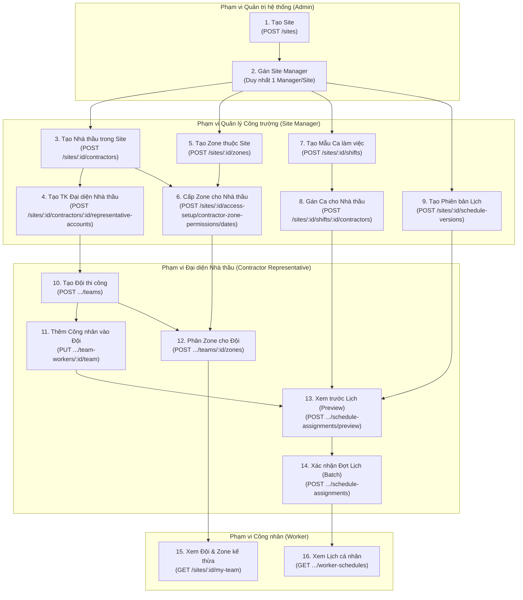
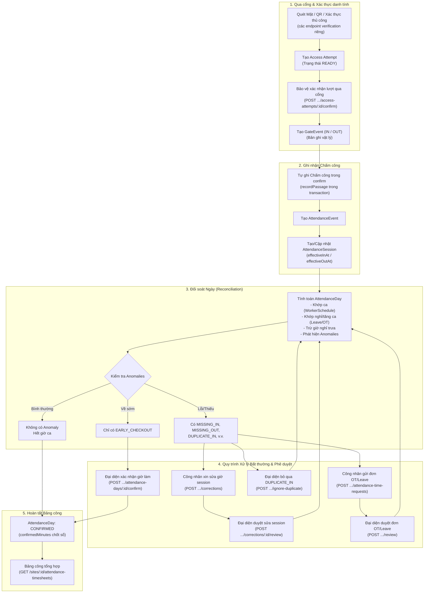

# Tài liệu API Thực tế: Luồng MF03 (Chấm công & Giờ làm) và MF07 (Quản lý Nhân lực & Lịch làm)

Tài liệu này mô tả các API **đang thực sự tồn tại trong mã nguồn** SmartSite (không suy đoán, không tự bịa endpoint hay trường dữ liệu chưa triển khai). Tất cả các API dưới đây được đối chiếu trực tiếp từ NestJS controllers, domain services, TypeORM entities, shared contracts (`@smartsite/contracts`), API client (`@smartsite/api-client`) và các bộ kiểm thử tự động (integration/unit tests).

---

## Mục lục

1. [Ranh giới Hệ thống & Nguyên tắc Thiết kế](#1-ranh-giới-hệ-thống--nguyên-tắc-thiết-kế)
2. [Bảng Phân Quyền API theo Vai Trò](#2-bảng-phân-quyền-api-theo-vai-trò)
3. [Sơ đồ Luồng Thực Tế (Mermaid)](#3-sơ-đồ-luồng-thực-tế-mermaid)
4. [MF07 — Quản lý Nhân lực & Lịch làm](#4-mf07--quản-lý-nhân-lực--lịch-làm)
   - [4.1. Nhà thầu & Đại diện Nhà thầu trong Site](#41-nhà-thầu--đại-diện-nhà-thầu-trong-site)
   - [4.2. Quản lý Đội (Contractor Teams) & Thành viên](#42-quản-lý-đội-contractor-teams--thành-viên)
   - [4.3. Quản lý Ca làm việc (Shifts) & Phiên bản Lịch](#43-quản-lý-ca-làm-việc-shifts--phiên-bản-lịch)
   - [4.4. Phân lịch làm việc theo Đội & Công nhân (Schedule Assignments)](#44-phân-lịch-làm-việc-theo-đội--công-nhân-schedule-assignments)
   - [4.5. Đổi ca, Hoán đổi ca & Nghỉ phép (Scheduling Workflow)](#45-đổi-ca-hoán-đổi-ca--nghỉ-phép-scheduling-workflow)
   - [4.6. Cấp Zone cho Nhà thầu (Site Manager)](#46-cấp-zone-cho-nhà-thầu-site-manager)
   - [4.7. Phân Zone cho Đội làm việc (Contractor Representative)](#47-phân-zone-cho-đội-làm-việc-contractor-representative)
   - [4.8. Xem Hồ sơ Đội & Zone của Công nhân](#48-xem-hồ-sơ-đội--zone-của-công-nhân)

- [4.9. Phê duyệt Site/Zone của công nhân và quyền trực tiếp](#49-phê-duyệt-sitezone-của-công-nhân-và-quyền-trực-tiếp)
- [4.10. API quản lý dành riêng Site Manager](#410-api-quản-lý-dành-riêng-site-manager)

5. [MF03 — Chấm công & Giờ làm](#5-mf03--chấm-công--giờ-làm)
   - [5.1. Nhận diện tại Cổng, Xác nhận Qua Cổng & Ghi nhận Chấm công](#51-nhận-diện-tại-cổng-xác-nhận-qua-cổng--ghi-nhận-chấm-công)
   - [5.2. Tổng quan Chấm công & Phiên làm việc (Sessions)](#52-tổng-quan-chấm-công--phiên-làm-việc-sessions)
   - [5.3. Chấm công theo Ngày (Attendance Days)](#53-chấm-công-theo-ngày-attendance-days)
   - [5.4. Xử lý Bất thường: Bỏ qua Lần Quét Trùng (Ignore Duplicate IN)](#54-xử-lý-bất-thường-bỏ-qua-lần-quét-trùng-ignore-duplicate-in)
   - [5.5. Yêu cầu Chỉnh sửa Giờ làm & Phê duyệt (Corrections)](#55-yêu-cầu-chỉnh-sửa-giờ-làm--phê-duyệt-corrections)
   - [5.6. Yêu cầu Tăng ca (Overtime) & Nghỉ phép (Leave) trong Ngày](#56-yêu-cầu-tăng-ca-overtime--nghỉ-phép-leave-trong-ngày)
   - [5.7. Xác nhận Giờ làm (Confirm Hours)](#57-xác-nhận-giờ-làm-confirm-hours)
   - [5.8. Bảng công Tổng hợp Đã Xác nhận (Timesheets)](#58-bảng-công-tổng-hợp-đã-xác-nhận-timesheets)
6. [Làm rõ Các Truy vấn & Bài toán Thực tế](#6-làm-rõ-các-truy-vấn--bài-toán-thực-tế)
   - [6.1. Tài khoản đại diện đang đại diện cho nhà thầu nào, tại Site nào?](#61-tài-khoản-đại-diện-đang-đại-diện-cho-nhà-thầu-nào-tại-site-nào)
   - [6.2. Nhà thầu đang tham gia những Site nào?](#62-nhà-thầu-đang-tham-gia-những-site-nào)
   - [6.3. Nhà thầu được cấp những Zone nào tại Site, thời hạn & trạng thái thu hồi/hết hạn?](#63-nhà-thầu-được-cấp-những-zone-nào-tại-site-thời-hạn--trạng-thái-thu-hồihết-hạn)
   - [6.4. Nhà thầu có bao nhiêu team, bao nhiêu công nhân?](#64-nhà-thầu-có-bao-nhiêu-team-bao-nhiêu-công-nhân)
   - [6.5. Team nào được phân lịch trong ngày chọn, ca nào, công nhân nào, Zone nào?](#65-team-nào-được-phân-lịch-trong-ngày-chọn-ca-nào-công-nhân-nào-zone-nào)
   - [6.6. Phân biệt "Được phân lịch làm" với "Thực tế có mặt/chấm công"](#66-phân-biệt-được-phân-lịch-làm-với-thực-tế-có-mặtchấm-công)
   - [6.7. Phân biệt "Zone được phân công" với "Quyền vào Zone thực tế"](#67-phân-biệt-zone-được-phân-công-với-quyền-vào-zone-thực-tế)
7. [Thứ tự Gọi API Xây dựng Màn hình Frontend](#7-thứ-tự-gọi-api-xây-dựng-màn-hình-frontend)
8. [Khoảng trống Triển khai & Khuyến nghị Kỹ thuật](#8-khoảng-trống-triển-khai--khuyến-nghị-kỹ-thuật)
9. [Bằng chứng đối chiếu và phạm vi kiểm tra](#9-bằng-chứng-đối-chiếu-và-phạm-vi-kiểm-tra)

---

## 1. Ranh giới Hệ thống & Nguyên tắc Thiết kế

Theo quy định tại [AGENTS.md](../AGENTS.md) và [apps/backend/AGENTS.md](../apps/backend/AGENTS.md):

- **NestJS Backend** là nguồn chân lý duy nhất (Single Source of Truth) về tài khoản, vai trò, dữ liệu phân cấp Site/Contractor/Team/Worker/Zone, ủy quyền truy cập, trạng thái chấm công và cảnh báo.
- **Dữ liệu AI / Nhận diện Khuôn mặt / Camera** là bằng chứng kỹ thuật (technical evidence), không phải quyết định thẩm quyền cuối cùng. Track ID không phải Worker ID.
- **Prefix toàn bộ HTTP API**: Tất cả endpoint nghiệp vụ đều có tiền tố `/api/v1` được định cấu hình tại [configureApplication](../apps/backend/src/configure-app.ts).
- **Quy tắc Kiểm tra Quyền (Authorization & Scope Enforcement)**: Bắt buộc kết hợp Vai trò (`UserRole`) và Phạm vi (`SiteId`, `ContractorId`, `WorkerId`). Thiếu hoặc sai phạm vi nghiệp vụ trả 403; thiếu/không hợp lệ phiên xác thực hoặc tài khoản bị vô hiệu hóa có thể trả 401 qua UserAuthGuard. Tài khoản có `mustChangePassword = true` bị hạn chế theo guard; tài khoản mới hiện dùng mật khẩu được cung cấp ngay, không bắt buộc đổi mật khẩu. Không suy ra quyền Backend từ menu Web.
- **Múi giờ & Thời gian**:
  - Lưu trữ cơ sở dữ liệu: Luôn dùng UTC (`timestamptz`).
  - Giao diện biên (API boundaries): Sử dụng chuỗi định dạng ISO 8601 / RFC 3339 có timezone offset hoặc đuôi `Z`.
  - Ngày lịch làm việc (`work_date`): Định dạng chuỗi `YYYY-MM-DD` kết hợp múi giờ IANA chuẩn (ví dụ: `Asia/Ho_Chi_Minh`).
  - Cửa sổ ca làm việc qua đêm (overnight shift): Tính toán chuyển đổi dựa trên múi giờ mẫu của ca làm, bảo toàn độ lệch ngày dương lịch theo quy tắc toán học tại [attendance-calculation.ts](../apps/backend/src/modules/workforce/attendance/attendance-calculation.ts).
- **Idempotency & Concurrency Control**:
  - Lệnh ghi nhạy cảm sử dụng `requestId` (UUID; xem giới hạn phiên bản ở từng DTO) để bảo vệ chống trùng lặp; gọi lại cùng `requestId` với dữ liệu tương đương sẽ trả lại bản ghi cũ thay vì lỗi trùng lặp (trùng ID nhưng khác dữ liệu trả về `409 CONFLICT`).
  - Lệnh cập nhật trạng thái dùng khóa lạc quan (Optimistic Locking) thông qua `expectedVersion` hoặc `expectedMembershipId`. Khi phiên bản bị lệch, trả về `409 CONFLICT`.

---

## 2. Bảng Phân Quyền API theo Vai Trò

Hệ thống phân định rõ ràng quyền hạn giữa các vai trò người dùng:

- **Global Admin**: Quản trị viên hệ thống (vai trò `ADMIN` với `siteId: null`). Có quyền cấu hình Site, tạo công nhân cấp Site và cấp tài khoản. Không quản lý nghiệp vụ nội bộ nhà thầu.
- **Site Manager**: Quản lý công trường được gán vào 1 Site cụ thể. Quản lý Zone, nhà thầu tham gia Site, cấp Zone cho nhà thầu, cấu hình mẫu ca làm việc (`Shift`), tạo phiên bản lịch (`ScheduleVersion`).
- **Contractor Representative**: Đại diện nhà thầu được gán vào một nhà thầu tại một Site cụ thể. Quản lý Đội (`ContractorTeam`), phân công nhân vào đội, phân Zone cho đội, phân lịch làm việc cho đội/công nhân, duyệt đổi ca, duyệt đơn nghỉ phép, duyệt tăng ca, duyệt chỉnh sửa giờ công, xác nhận giờ công.
- **Worker**: Công nhân trực thuộc nhà thầu tại Site. Xem đội của mình, xem lịch làm việc, xin đổi ca, xác nhận hoán đổi ca với đồng nghiệp, xin nghỉ phép, xin tăng ca, yêu cầu chỉnh sửa giờ chấm công của mình.
- **Security Officer**: Nhân viên an ninh cổng tại Site. Vận hành xác thực cổng (khuôn mặt, QR, xác thực thủ công), xác nhận lượt qua cổng (`confirmPassage`) và ghi nhận chấm công (`recordAttendance`).

| Nhóm API                    | Endpoint                                                                         |    Admin    |    Site Manager    | Contractor Representative |         Worker          |  Security Officer  |
| :-------------------------- | :------------------------------------------------------------------------------- | :---------: | :----------------: | :-----------------------: | :---------------------: | :----------------: |
| **Site & Contractor**       | `GET /api/v1/sites`                                                              | ✅ (Tất cả) | ✅ (Site được gán) |    ✅ (Site được gán)     |   ✅ (Site được gán)    | ✅ (Site được gán) |
|                             | `POST /api/v1/sites/:siteId/contractors`                                         |     ❌      |         ✅         |            ❌             |           ❌            |         ❌         |
|                             | `GET /api/v1/sites/:siteId/contractors`                                          |     ✅      |         ✅         |   ✅ (Chỉ NT của mình)    |  ✅ (Chỉ NT của mình)   |         ❌         |
|                             | `POST /api/v1/sites/:siteId/contractors/:id/representatives`                     |     ❌      |         ✅         |            ❌             |           ❌            |         ❌         |
|                             | `POST /api/v1/sites/:siteId/contractors/:id/representative-accounts`             |     ❌      |         ✅         |            ❌             |           ❌            |         ❌         |
|                             | `GET /api/v1/contractor-dashboard/scopes`                                        |     ❌      |         ❌         |            ✅             |           ❌            |         ❌         |
|                             | `GET /api/v1/sites/:siteId/contractors/:id/dashboard`                            |     ❌      |         ❌         |            ✅             |           ❌            |         ❌         |
|                             | `GET /api/v1/sites/:siteId/management/overview`                                  |     ❌      |         ✅         |            ❌             |           ❌            |         ❌         |
|                             | `GET /api/v1/sites/:siteId/management/contractors/:id`                           |     ❌      |         ✅         |            ❌             |           ❌            |         ❌         |
| **Zone Setup**              | `POST /api/v1/sites/:siteId/zones`                                               |     ❌      |         ✅         |            ❌             |           ❌            |         ❌         |
|                             | `GET /api/v1/sites/:siteId/zones`                                                |     ✅      |         ✅         |            ❌             |           ❌            |         ❌         |
|                             | `GET /api/v1/sites/:siteId/access-setup`                                         |     ✅      |         ✅         |   ✅ (Chỉ NT của mình)    |           ❌            |         ❌         |
|                             | `POST /api/v1/sites/:siteId/access-setup/contractor-zone-permissions/dates`      |     ❌      |         ✅         |            ❌             |           ❌            |         ❌         |
|                             | `POST /api/v1/sites/:siteId/access-setup/contractor-zone-permissions/:id/revoke` |     ❌      |         ✅         |            ❌             |           ❌            |         ❌         |
| **Team & Team Zones**       | `POST /api/v1/sites/:siteId/contractors/:id/teams`                               |     ❌      |         ❌         |            ✅             |           ❌            |         ❌         |
|                             | `GET /api/v1/sites/:siteId/contractors/:id/teams`                                |     ❌      |         ❌         |            ✅             |           ❌            |         ❌         |
|                             | `PATCH /api/v1/sites/:siteId/contractors/:id/teams/:teamId`                      |     ❌      |         ❌         |            ✅             |           ❌            |         ❌         |
|                             | `POST /api/v1/sites/:siteId/contractors/:id/teams/:teamId/archive`               |     ❌      |         ❌         |            ✅             |           ❌            |         ❌         |
|                             | `GET /api/v1/sites/:siteId/contractors/:id/team-workers`                         |     ❌      |         ❌         |            ✅             |           ❌            |         ❌         |
|                             | `PUT /api/v1/sites/:siteId/contractors/:id/team-workers/:wId/team`               |     ❌      |         ❌         |            ✅             |           ❌            |         ❌         |
|                             | `GET /api/v1/sites/:siteId/contractors/:id/teams/:teamId/zones`                  |     ❌      |         ❌         |            ✅             |           ❌            |         ❌         |
|                             | `POST /api/v1/sites/:siteId/contractors/:id/teams/:teamId/zones`                 |     ❌      |         ❌         |            ✅             |           ❌            |         ❌         |
|                             | `PATCH /api/v1/sites/:siteId/contractors/:id/teams/:teamId/zones/:pId`           |     ❌      |         ❌         |            ✅             |           ❌            |         ❌         |
|                             | `POST /api/v1/sites/:siteId/contractors/:id/teams/:teamId/zones/:pId/revoke`     |     ❌      |         ❌         |            ✅             |           ❌            |         ❌         |
|                             | `GET /api/v1/sites/:siteId/my-team`                                              |     ❌      |         ❌         |            ❌             |           ✅            |         ❌         |
| **Ca & Phiên bản Lịch**     | `POST /api/v1/sites/:siteId/shifts`                                              |     ❌      |         ✅         |            ❌             |           ❌            |         ❌         |
|                             | `GET /api/v1/sites/:siteId/shifts`                                               |     ✅      |         ✅         |            ✅             |           ✅            |         ❌         |
|                             | `POST /api/v1/sites/:siteId/shifts/:id/contractors`                              |     ❌      |         ✅         |            ❌             |           ❌            |         ❌         |
|                             | `POST /api/v1/sites/:siteId/shifts/:id/archive`                                  |     ❌      |         ✅         |            ❌             |           ❌            |         ❌         |
|                             | `POST /api/v1/sites/:siteId/schedule-versions`                                   |     ❌      |         ✅         |            ❌             |           ❌            |         ❌         |
|                             | `GET /api/v1/sites/:siteId/schedule-versions`                                    |     ✅      |         ✅         |            ✅             |           ✅            |         ✅         |
| **Phân lịch**               | `POST /api/v1/sites/:siteId/schedule-assignments/preview`                        |     ❌      |         ❌         |            ✅             |           ❌            |         ❌         |
|                             | `POST /api/v1/sites/:siteId/schedule-assignments`                                |     ❌      |         ❌         |            ✅             |           ❌            |         ❌         |
|                             | `GET /api/v1/sites/:siteId/schedule-assignments`                                 |     ❌      |         ❌         |            ✅             |           ❌            |         ❌         |
|                             | `POST /api/v1/sites/:siteId/schedule-assignments/:id/change`                     |     ❌      |         ❌         |            ✅             |           ❌            |         ❌         |
|                             | `GET /api/v1/sites/:siteId/worker-schedules`                                     |     ✅      |         ✅         |   ✅ (Chỉ NT của mình)    | ✅ (Chỉ lịch của mình)  |         ❌         |
| **Quy trình Đổi ca & Nghỉ** | `GET /api/v1/sites/:siteId/worker-schedules/:id/eligible-shifts`                 |     ✅      |         ✅         |       ✅ (Scope NT)       |           ✅            |         ❌         |
|                             | `POST /api/v1/sites/:siteId/shift-change-requests`                               |     ❌      |         ❌         |            ❌             |           ✅            |         ❌         |
|                             | `PATCH /api/v1/sites/:siteId/shift-change-requests/:id/approve`                  |     ❌      |         ❌         |            ✅             |           ❌            |         ❌         |
|                             | `GET /api/v1/sites/:siteId/worker-schedules/:id/swap-candidates`                 |     ✅      |         ✅         |       ✅ (Scope NT)       |           ✅            |         ❌         |
|                             | `POST /api/v1/sites/:siteId/shift-swap-requests`                                 |     ❌      |         ❌         |            ❌             |           ✅            |         ❌         |
|                             | `PATCH /api/v1/sites/:siteId/shift-swap-requests/:id/confirm`                    |     ❌      |         ❌         |            ❌             |    ✅ (Đồng nghiệp)     |         ❌         |
|                             | `PATCH /api/v1/sites/:siteId/shift-swap-requests/:id/approve`                    |     ❌      |         ❌         |            ✅             |           ❌            |         ❌         |
|                             | `POST /api/v1/sites/:siteId/absence-requests`                                    |     ❌      |         ❌         |            ❌             |           ✅            |         ❌         |
|                             | `PATCH /api/v1/sites/:siteId/absence-requests/:id/approve`                       |     ❌      |         ❌         |            ✅             |           ❌            |         ❌         |
| **Chấm công Cổng**          | `POST /api/v1/sites/:siteId/gates/:id/face-verifications`                        |     ✅      |         ✅         |            ❌             |           ❌            |         ✅         |
|                             | `POST /api/v1/sites/:siteId/access-attempts/:id/confirm`                         |     ✅      |         ✅         |            ❌             |           ❌            |         ✅         |
|                             | `POST /api/v1/sites/:siteId/gate-events/:id/attendance`                          |     ✅      |         ❌         |            ❌             |    ✅ (Tự check-in)     |         ✅         |
| **Xử lý Chấm công Ngày**    | `GET /api/v1/sites/:siteId/attendance`                                           |     ✅      |         ✅         |            ✅             |           ✅            |         ✅         |
|                             | `GET /api/v1/sites/:siteId/attendance-days`                                      |     ✅      |         ✅         |            ✅             |           ✅            |         ✅         |
|                             | `GET /api/v1/sites/:siteId/attendance-days/:id`                                  |     ✅      |         ✅         |            ✅             |           ✅            |         ✅         |
|                             | `POST /api/v1/sites/:siteId/attendance-sessions/:id/corrections`                 |     ❌      |         ❌         |            ❌             | ✅ (Chỉ phiên của mình) |         ❌         |
|                             | `POST /api/v1/sites/:siteId/attendance-corrections/:id/review`                   |     ❌      |         ❌         |            ✅             |           ❌            |         ❌         |
|                             | `POST /api/v1/sites/:siteId/attendance-time-requests` (OT/Leave)                 |     ❌      |         ❌         |            ❌             |           ✅            |         ❌         |
|                             | `POST /api/v1/sites/:siteId/attendance-time-requests/:kind/:id/review`           |     ❌      |         ❌         |            ✅             |           ❌            |         ❌         |
|                             | `POST /api/v1/sites/:siteId/attendance-sessions/:id/ignore-duplicate`            |     ❌      |         ❌         |            ✅             |           ❌            |         ❌         |
|                             | `POST /api/v1/sites/:siteId/attendance-days/:id/confirm`                         |     ❌      |         ❌         |            ✅             |           ❌            |         ❌         |
|                             | `GET /api/v1/sites/:siteId/attendance-timesheets`                                |     ✅      |         ✅         |            ✅             |           ✅            |         ✅         |

---

Bảng thể hiện quyền Backend, không phải menu Web; mỗi cột giả định tài khoản chỉ có vai trò đó, không có thêm assignment cho vai trò khác. Safety Officer (không có cột riêng) cũng được xác thực/xác nhận qua cổng trong Site và thực hiện safety-review; không được duyệt giờ công. Global Admin cũng qua được một số API vận hành cổng và ghi chấm công. Đọc eligible-shifts/swap-candidates cho phép Admin, Site Manager, đại diện có scope và Worker chính chủ; tạo/duyệt yêu cầu vẫn dùng các vai trò riêng.

## 3. Sơ đồ Luồng Thực Tế (Mermaid)

### 3.1. Luồng Cấp Bậc Tổ chức, Phân quyền Zone và Phân lịch Làm việc (MF07)



### 3.2. Luồng Chấm công, Xử lý Bất thường và Xác nhận Bảng công (MF03)



---

## 4. MF07 — Quản lý Nhân lực & Lịch làm

### 4.1. Nhà thầu & Đại diện Nhà thầu trong Site

#### API 4.1.1: Tạo Nhà thầu trong Site (Tự động sinh mã)

- **Đường dẫn**: `POST /api/v1/sites/:siteId/contractors`
- **Controller**: [ContractorsController.create](../apps/backend/src/modules/workforce/directory/contractors.controller.ts)
- **Service**: [WorkforceConfigurationService.createContractor](../apps/backend/src/modules/workforce/directory/workforce-configuration.service.ts)
- **Client Method**: `SmartSiteManagementClient.createContractor`
- **Mục đích**: Site Manager tạo một nhà thầu mới tham gia Site. Nếu không truyền `code`, hệ thống tự sinh mã `CTR-<UPPERCASE_UUID>`. Tự động tạo bản ghi tham gia `contractor_site_participation` với `validFrom = now()`, `validUntil = null`.
- **Vai trò cho phép**: `SITE_MANAGER` (được gán tại `siteId`).
- **Phạm vi (Scope)**: Site Manager của `siteId`.
- **Request Body**:

```json
{
  "name": "Công ty Xây dựng Alpha",
  "code": "CTR-ALPHA-01"
}
```

- **Response** (HTTP 201):

```json
{
  "id": "11111111-1111-4111-8111-111111111111",
  "siteId": "00000000-0000-4000-8000-000000000001",
  "code": "CTR-ALPHA-01",
  "name": "Công ty Xây dựng Alpha",
  "isActive": true,
  "createdAt": "2026-10-12T08:00:00.000Z"
}
```

- **Xử lý Lỗi & Xung đột**:
  - `400 BAD_REQUEST`: Tên rỗng hoặc mã không đúng định dạng `/^[A-Z0-9][A-Z0-9_-]{1,63}$/`.
  - `403 FORBIDDEN`: Không phải Site Manager của `siteId`.
  - `409 CONFLICT`: Mã nhà thầu đã tồn tại nhưng gắn với tên khác hoặc nhà thầu không hoạt động.

#### API 4.1.2: Tạo Tài khoản và Gán Đại diện Nhà thầu (Nguyên tử)

- **Đường dẫn**: `POST /api/v1/sites/:siteId/contractors/:contractorId/representative-accounts`
- **Controller**: [SiteRepresentativesController.create](../apps/backend/src/modules/users/site-representatives.controller.ts)
- **Service**: [SiteRepresentativesService.create](../apps/backend/src/modules/users/site-representatives.controller.ts)
- **Client Method**: `SmartSiteManagementClient.createSiteRepresentative`
- **Mục đích**: Site Manager tạo một tài khoản người dùng mới (vai trò `CONTRACTOR_REPRESENTATIVE` tại Site) đồng thời gán vào nhà thầu trong một transaction PostgreSQL duy nhất. Mật khẩu cung cấp có thể sử dụng đăng nhập ngay.
- **Vai trò cho phép**: `SITE_MANAGER` (được gán tại `siteId`).
- **Request Body**:

```json
{
  "username": "rep_alpha",
  "displayName": "Nguyễn Văn Đại Diện",
  "temporaryPassword": "Password123!"
}
```

- **Response** (HTTP 201):

```json
{
  "id": "22222222-2222-4222-8222-222222222222",
  "username": "rep_alpha",
  "displayName": "Nguyễn Văn Đại Diện",
  "isActive": true,
  "mustChangePassword": false,
  "roleAssignments": [
    {
      "role": "CONTRACTOR_REPRESENTATIVE",
      "siteId": "00000000-0000-4000-8000-000000000001"
    }
  ]
}
```

- **Xử lý Lỗi**:
  - `409 CONFLICT`: Username đã tồn tại (`uq_app_user_username`) hoặc đại diện đã được gán.

#### API 4.1.3: Tra cứu Phạm vi của Tài khoản Đại diện Đang Đăng nhập

- **Đường dẫn**: `GET /api/v1/contractor-dashboard/scopes`
- **Controller**: [ContractorTeamsController.scopes](../apps/backend/src/modules/workforce/teams/contractor-teams.controller.ts)
- **Service**: [ContractorTeamsService.scopes](../apps/backend/src/modules/workforce/teams/contractor-teams.service.ts)
- **Client Method**: [SmartSiteManagementClient.contractorDashboardScopes](../packages/api-client/src/management.ts)
- **Shared Contract**: `ContractorDashboardScope` trong [contractor-team-api.ts](../contracts/src/contractor-team-api.ts)
- **Mục đích**: Khi Đại diện nhà thầu đăng nhập, gọi API này để biết mình đang đại diện cho nhà thầu nào và tại những Site nào đang có hiệu lực.
- **Vai trò cho phép**: `CONTRACTOR_REPRESENTATIVE` có assignment hợp lệ. Admin không được bypass: tài khoản không có assignment đại diện hợp lệ nhận danh sách `items` rỗng, không nhận phạm vi toàn hệ thống.
- **Query / Body**: Không có.
- **Response** (HTTP 200):

```json
{
  "items": [
    {
      "siteId": "00000000-0000-4000-8000-000000000001",
      "siteName": "Công trường Landmark Demo",
      "siteCode": "SITE-LANDMARK",
      "contractorId": "11111111-1111-4111-8111-111111111111",
      "contractorName": "Công ty Xây dựng Alpha"
    }
  ]
}
```

- **Logic Kiểm tra**: Lọc bảng `contractor_representative_assignment` theo `userId = actor.id`. Với mỗi bản ghi, re-check: tài khoản active, vai trò đại diện tại site còn hiệu lực, và nhà thầu có tham gia Site còn hiệu lực (`contractor_site_participation`). Bản ghi không đủ điều kiện sẽ bị loại bỏ.

---

### 4.2. Quản lý Đội (Contractor Teams) & Thành viên

#### API 4.2.1: Bảng số liệu Tổng quan Nhà thầu (Contractor Dashboard)

- **Đường dẫn**: `GET /api/v1/sites/:siteId/contractors/:contractorId/dashboard`
- **Controller**: [ContractorTeamsController.dashboard](../apps/backend/src/modules/workforce/teams/contractor-teams.controller.ts)
- **Service**: [ContractorTeamsService.dashboard](../apps/backend/src/modules/workforce/teams/contractor-teams.service.ts)
- **Client Method**: [SmartSiteManagementClient.contractorDashboard](../packages/api-client/src/management.ts)
- **Mục đích**: Trả về tổng số công nhân, tổng số đội, và số công nhân chưa được xếp đội của nhà thầu tại Site.
- **Vai trò cho phép**: `CONTRACTOR_REPRESENTATIVE` phụ trách `contractorId` tại `siteId`.
- **Response** (HTTP 200):

```json
{
  "scope": {
    "siteId": "00000000-0000-4000-8000-000000000001",
    "siteName": "Công trường Landmark Demo",
    "siteCode": "SITE-LANDMARK",
    "contractorId": "11111111-1111-4111-8111-111111111111",
    "contractorName": "Công ty Xây dựng Alpha"
  },
  "workerCount": 15,
  "teamCount": 3,
  "unassignedWorkerCount": 2
}
```

#### API 4.2.2: Tạo Đội Thi công (Contractor Team)

- **Đường dẫn**: `POST /api/v1/sites/:siteId/contractors/:contractorId/teams`
- **Controller**: [ContractorTeamsController.create](../apps/backend/src/modules/workforce/teams/contractor-teams.controller.ts)
- **Service**: [ContractorTeamsService.create](../apps/backend/src/modules/workforce/teams/contractor-teams.service.ts)
- **Client Method**: [SmartSiteManagementClient.createContractorTeam](../packages/api-client/src/management.ts)
- **Idempotency**: Dùng `requestId` làm Primary Key `id` của đội. Sử dụng khóa advisory `pg_advisory_xact_lock(hashtext('team-create:' || requestId))`.
- **Request Body**:

```json
{
  "requestId": "33333333-3333-4333-8333-333333333333",
  "name": "Đội Thi công Cốt thép 01",
  "description": "Chịu trách nhiệm thi công cốt thép sàn tầng hầm"
}
```

- **Response** (HTTP 201):

```json
{
  "id": "33333333-3333-4333-8333-333333333333",
  "siteId": "00000000-0000-4000-8000-000000000001",
  "contractorId": "11111111-1111-4111-8111-111111111111",
  "name": "Đội Thi công Cốt thép 01",
  "description": "Chịu trách nhiệm thi công cốt thép sàn tầng hầm",
  "isActive": true,
  "version": 1,
  "memberCount": 0,
  "zoneAssignments": []
}
```

- **Xử lý Lỗi**: `409 CONFLICT` nếu tên đội đã tồn tại trong cùng Site và nhà thầu (`uq_team_active_name`).

#### API 4.2.3: Chỉnh sửa Đội Thi công (Update Team)

- **Đường dẫn**: `PATCH /api/v1/sites/:siteId/contractors/:contractorId/teams/:id`
- **Controller**: [ContractorTeamsController.update](../apps/backend/src/modules/workforce/teams/contractor-teams.controller.ts)
- **Service**: [ContractorTeamsService.update](../apps/backend/src/modules/workforce/teams/contractor-teams.service.ts)
- **Optimistic Locking**: Bắt buộc truyền `expectedVersion`.
- **Request Body**:

```json
{
  "expectedVersion": 1,
  "name": "Đội Cốt thép 01 (Khu A)",
  "description": "Cập nhật khu vực làm việc phụ trách"
}
```

- **Response** (HTTP 200): Trả về chi tiết đội với `version: 2`.
- **Xử lý Lỗi**: `409 CONFLICT` nếu đội đã bị sửa bởi phiên khác (`version !== expectedVersion`) hoặc đội đã lưu trữ (`isActive = false`).

#### API 4.2.4: Lưu trữ Đội Thi công (Archive Team)

- **Đường dẫn**: `POST /api/v1/sites/:siteId/contractors/:contractorId/teams/:id/archive`
- **Controller**: [ContractorTeamsController.archive](../apps/backend/src/modules/workforce/teams/contractor-teams.controller.ts)
- **Service**: [ContractorTeamsService.archive](../apps/backend/src/modules/workforce/teams/contractor-teams.service.ts)
- **Ràng buộc Nghiệp vụ**: Bắt buộc phải chuyển hoặc gỡ toàn bộ công nhân đang hoạt động khỏi đội trước khi lưu trữ (`leftAt IS NULL`). Nếu còn thành viên active, trả về `409 CONFLICT`. Thành viên inactive sẽ được đóng tự động.
- **Request Body**:

```json
{
  "expectedVersion": 2,
  "reason": "Hoàn thành giai đoạn móng và giải thể đội"
}
```

- **Response** (HTTP 201): Đội có `isActive: false`, `version: 3`.

#### API 4.2.5: Thêm, Chuyển hoặc Gỡ Công nhân khỏi Đội (Assign / Transfer / Remove)

- **Đường dẫn**: `PUT /api/v1/sites/:siteId/contractors/:contractorId/team-workers/:workerId/team`
- **Controller**: [ContractorTeamsController.assign](../apps/backend/src/modules/workforce/teams/contractor-teams.controller.ts)
- **Service**: [ContractorTeamsService.assign](../apps/backend/src/modules/workforce/teams/contractor-teams.service.ts)
- **Client Method**: [SmartSiteManagementClient.assignContractorTeam](../packages/api-client/src/management.ts)
- **Ràng buộc Concurrency & Thao tác**:
  - Gán vào đội mới: `expectedMembershipId: null`, `teamId: "<uuid>"`.
  - Chuyển đội: `expectedMembershipId: "<id-hiện-tại>"`, `teamId: "<id-đội-mới>"`, bắt buộc `reason` (tối thiểu 5 ký tự).
  - Gỡ khỏi đội (trở thành unassigned): `expectedMembershipId: "<id-hiện-tại>"`, `teamId: null`, bắt buộc `reason`.
- **Request Body (Ví dụ chuyển đội)**:

```json
{
  "requestId": "44444444-4444-4444-8444-444444444444",
  "expectedMembershipId": "55555555-5555-4555-8555-555555555555",
  "teamId": "33333333-3333-4333-8333-333333333333",
  "reason": "Điều chuyển hỗ trợ thi công cốt thép sàn hầm"
}
```

- **Response** (HTTP 200):

```json
{
  "workerId": "66666666-6666-4666-8666-666666666666",
  "displayName": "Trần Văn Thợ",
  "membershipId": "44444444-4444-4444-8444-444444444444",
  "teamId": "33333333-3333-4333-8333-333333333333",
  "teamName": "Đội Thi công Cốt thép 01"
}
```

- **Xử lý Lỗi**: `409 CONFLICT` nếu thành viên đã bị đổi đội trước đó (`current.id !== expectedMembershipId`).

---

### 4.3. Quản lý Ca làm việc (Shifts) & Phiên bản Lịch

#### API 4.3.1: Tạo Mẫu Ca làm việc (Shift Template)

- **Đường dẫn**: `POST /api/v1/sites/:siteId/shifts`
- **Controller**: [ScheduleConfigurationController.createShift](../apps/backend/src/modules/workforce/scheduling/schedule-configuration.controller.ts)
- **Service**: [ScheduleConfigurationService.createShift](../apps/backend/src/modules/workforce/scheduling/schedule-configuration.service.ts)
- **Vai trò cho phép**: `SITE_MANAGER` (tại `siteId`).
- **Quy tắc Giờ & Nghỉ Trưa**: Thời gian `startsAt`, `endsAt`, `breakStartsAt`, `breakEndsAt` thể hiện giờ đồng hồ cục bộ trong ngày mẫu kết hợp múi giờ `timezone` (ví dụ: `Asia/Ho_Chi_Minh`). Nếu ca qua đêm (overnight), `endsAt` có ngày lớn hơn `startsAt`. Giờ nghỉ trưa phải nằm trọn vẹn trong khoảng thời gian ca làm việc.
- **Request Body**:

```json
{
  "name": "Ca Ngày Chuẩn (07:00 - 16:00)",
  "startsAt": "2026-01-01T07:00:00+07:00",
  "endsAt": "2026-01-01T16:00:00+07:00",
  "breakStartsAt": "2026-01-01T11:30:00+07:00",
  "breakEndsAt": "2026-01-01T12:30:00+07:00",
  "timezone": "Asia/Ho_Chi_Minh"
}
```

- **Response** (HTTP 201): Trả về đối tượng `Shift` với `archivedAt: null`.

#### API 4.3.2: Site Manager Cấp Ca cho Nhà thầu

- **Đường dẫn**: `POST /api/v1/sites/:siteId/shifts/:shiftId/contractors`
- **Controller**: [ScheduleConfigurationController.assignShiftToContractor](../apps/backend/src/modules/workforce/scheduling/schedule-configuration.controller.ts)
- **Mục đích**: Site Manager cấp quyền cho phép một nhà thầu được sử dụng ca này để phân lịch cho công nhân của họ. Nhà thầu chỉ được phân lịch theo các ca đã được cấp quyền.
- **Request Body**:

```json
{
  "contractorId": "11111111-1111-4111-8111-111111111111"
}
```

- **Response** (HTTP 201):

```json
{
  "id": "77777777-7777-4777-8777-777777777777",
  "siteId": "00000000-0000-4000-8000-000000000001",
  "shiftId": "88888888-8888-4888-8888-888888888888",
  "contractorId": "11111111-1111-4111-8111-111111111111",
  "createdAt": "2026-10-12T08:00:00.000Z"
}
```

#### API 4.3.3: Lưu trữ Mẫu Ca làm việc (Shift Archival)

- **Đường dẫn**: `POST /api/v1/sites/:siteId/shifts/:shiftId/archive`
- **Controller**: [ScheduleConfigurationController.archiveShift](../apps/backend/src/modules/workforce/scheduling/schedule-configuration.controller.ts)
- **Tài liệu Chi tiết**: [Shift archival (MF03/MF07)](../docs/operations/shift-archival.md)
- **Hành vi**:
  - Đánh dấu `archived_at = CURRENT_TIMESTAMP`. Không xóa khỏi cơ sở dữ liệu.
  - Ca đã lưu trữ sẽ bị ẩn khỏi bộ chọn phân lịch mới và bị cấm gán vào lịch mới (`409 CONFLICT`).
  - Lịch cũ đã phân công, dữ liệu chấm công lịch sử, yêu cầu đổi ca đã tồn tại vẫn bảo toàn nguyên vẹn.
  - Lặp lại request trả về cùng timestamp (idempotent).

#### API 4.3.4: Tạo Phiên bản Lịch (Schedule Version)

- **Đường dẫn**: `POST /api/v1/sites/:siteId/schedule-versions`
- **Controller**: [ScheduleConfigurationController.createScheduleVersion](../apps/backend/src/modules/workforce/scheduling/schedule-configuration.controller.ts)
- **Mục đích**: Site Manager tạo khung phiên bản lịch làm việc theo khoảng ngày (`effectiveFrom`, `effectiveUntil`). Các lịch làm việc cá nhân bắt buộc gắn với một `scheduleVersionId` có hiệu lực.
- **Request Body**:

```json
{
  "effectiveFrom": "2026-10-01T00:00:00Z",
  "effectiveUntil": "2026-10-31T23:59:59Z"
}
```

- **Response** (HTTP 201):

```json
{
  "id": "99999999-9999-4999-8999-999999999999",
  "siteId": "00000000-0000-4000-8000-000000000001",
  "version": 1,
  "effectiveFrom": "2026-10-01T00:00:00.000Z",
  "effectiveUntil": "2026-10-31T23:59:59.000Z"
}
```

---

### 4.4. Phân lịch làm việc theo Đội & Công nhân (Schedule Assignments)

Tài liệu vận hành: [Team schedule assignments](../docs/operations/team-schedule-assignments.md).

#### API 4.4.1: Xem trước Đợt Phân lịch (Preview Schedule Assignment)

- **Đường dẫn**: `POST /api/v1/sites/:siteId/schedule-assignments/preview`
- **Controller**: [ScheduleAssignmentController.preview](../apps/backend/src/modules/workforce/scheduling/schedule-assignment.controller.ts)
- **Service**: [ScheduleAssignmentService.preview](../apps/backend/src/modules/workforce/scheduling/schedule-assignment.service.ts)
- **Shared Contract**: `ScheduleAssignmentInput`, `ScheduleAssignmentPreview` trong [schedule-assignment-api.ts](../contracts/src/schedule-assignment-api.ts)
- **Vai trò cho phép**: `CONTRACTOR_REPRESENTATIVE` phụ trách nhà thầu tại Site.
- **Chế độ Lặp (`mode`)**:
  - `DAY`: Phân cho 1 ngày duy nhất (`fromDate === toDate`).
  - `WEEK`: Phân cho 1 tuần (`fromDate` bắt buộc là Thứ Hai, `toDate` là Chủ Nhật cùng tuần).
  - `REPEAT`: Phân lặp lại theo danh sách thứ trong tuần (`weekdays`: 1=Thứ Hai ... 7=Chủ Nhật) trong khoảng `fromDate` đến `toDate`.
- **Chọn thành viên**: Bỏ `selectedWorkerIds` để dùng toàn bộ roster hiện tại; nếu truyền thì mảng phải có 1–500 UUID duy nhất thuộc team. Mảng rỗng bị 400.
- **Giới hạn**: Tối đa 366 ngày và không quá 5,000 công nhân-ngày (`worker-days`).
- **Request Body**:

```json
{
  "contractorId": "11111111-1111-4111-8111-111111111111",
  "scheduleVersionId": "99999999-9999-4999-8999-999999999999",
  "shiftId": "88888888-8888-4888-8888-888888888888",
  "target": "TEAM",
  "teamId": "33333333-3333-4333-8333-333333333333",
  "mode": "REPEAT",
  "fromDate": "2026-10-12",
  "toDate": "2026-10-16",
  "weekdays": [1, 2, 3, 4, 5]
}
```

- **Response** (HTTP 201):

```json
{
  "fingerprint": "aaaaaaaaaaaaaaaaaaaaaaaaaaaaaaaaaaaaaaaaaaaaaaaaaaaaaaaaaaaaaaaa",
  "targetName": "Đội Thi công Cốt thép 01",
  "members": [
    {
      "workerId": "66666666-6666-4666-8666-666666666666",
      "workerName": "Trần Văn Thợ",
      "membershipId": "44444444-4444-4444-8444-444444444444"
    }
  ],
  "dates": ["2026-10-12", "2026-10-13", "2026-10-14", "2026-10-15", "2026-10-16"],
  "assignmentCount": 5,
  "conflicts": []
}
```

#### API 4.4.2: Xác nhận Tạo Đợt Phân lịch Hàng loạt (Confirm Schedule Assignment)

- **Đường dẫn**: `POST /api/v1/sites/:siteId/schedule-assignments`
- **Controller**: [ScheduleAssignmentController.create](../apps/backend/src/modules/workforce/scheduling/schedule-assignment.controller.ts)
- **Idempotency & Khóa Kiểm tra**: Yêu cầu `requestId` và `expectedFingerprint`. Nếu fingerprint bị lệch (do danh sách thành viên đội thay đổi hoặc có lịch xung đột vừa được tạo), giao dịch bị hủy và trả về `409 CONFLICT`.
- **Hành vi**: Toàn bộ bản ghi `worker_schedule` cho từng công nhân và từng ngày làm việc được tạo ngay lập tức (materialized) trong 1 transaction, không cần background worker. Lưu lại bản ghi lịch sử `schedule_assignment_batch`.
- **Request Body**:

```json
{
  "requestId": "aaaaaaaa-aaaa-4aaa-8aaa-aaaaaaaaaaaa",
  "expectedFingerprint": "aaaaaaaaaaaaaaaaaaaaaaaaaaaaaaaaaaaaaaaaaaaaaaaaaaaaaaaaaaaaaaaa",
  "contractorId": "11111111-1111-4111-8111-111111111111",
  "scheduleVersionId": "99999999-9999-4999-8999-999999999999",
  "shiftId": "88888888-8888-4888-8888-888888888888",
  "target": "TEAM",
  "teamId": "33333333-3333-4333-8333-333333333333",
  "mode": "REPEAT",
  "fromDate": "2026-10-12",
  "toDate": "2026-10-16",
  "weekdays": [1, 2, 3, 4, 5]
}
```

- **Response** (HTTP 201): Trả về đối tượng `ScheduleAssignmentBatchResponse` với `id`, `version: 1`, `dates`, `members`.

#### API 4.4.3: Thay đổi hoặc Hủy Lịch theo Đợt (Change / Cancel Assignment Batch)

- **Đường dẫn**: `POST /api/v1/sites/:siteId/schedule-assignments/:id/change`
- **Controller**: [ScheduleAssignmentController.change](../apps/backend/src/modules/workforce/scheduling/schedule-assignment.controller.ts)
- **Phạm vi tác động (`scope`)**:
  - `DAY`: Chỉ ngày được chọn (`workDate`).
  - `FROM_DATE`: Từ ngày được chọn trở về sau.
  - `UNSTARTED`: Toàn bộ các ca làm việc trong đợt chưa bắt đầu (bỏ qua ngày đã qua hoặc ca đã bắt đầu).
- **Quy tắc Bảo vệ Chấm công (Attendance Protection)**:
  - Ca làm việc đã bắt đầu hoặc ngày làm việc đã có bản ghi chấm công (`attendance_day` hoặc `attendance_event`) KHÔNG THỂ bị hủy hoặc đổi ca thông qua tính năng này.
  - Các ca có yêu cầu nghỉ phép (`absence_request`), tăng ca (`overtime_request`) hoặc đổi ca đang pending/approved cũng ngăn chặn việc sửa đổi.
  - Khi thực hiện thành công, tự động gửi thông báo trong ứng dụng (`user_notification`) đến tài khoản công nhân bị ảnh hưởng với loại sự kiện `SCHEDULE_CHANGED` hoặc `SCHEDULE_CANCELLED`.
- **Request Body**:

```json
{
  "requestId": "bbbbbbbb-bbbb-4bbb-8bbb-bbbbbbbbbbbb",
  "expectedVersion": 1,
  "action": "CHANGE_SHIFT",
  "scope": "UNSTARTED",
  "workDate": "2026-10-12",
  "shiftId": "88888888-8888-4888-8888-888888888889",
  "reason": "Điều chỉnh theo tiến độ đổ bê tông sàn"
}
```

- **Response** (HTTP 201):

```json
{
  "id": "aaaaaaaa-aaaa-4aaa-8aaa-aaaaaaaaaaaa",
  "version": 2,
  "changedCount": 5,
  "skippedCount": 0
}
```

#### API 4.4.4: Tra cứu Danh sách Lịch phân công Công nhân

- **Đường dẫn**: `GET /api/v1/sites/:siteId/worker-schedules`
- **Controller**: [ScheduleConfigurationController.listWorkerSchedules](../apps/backend/src/modules/workforce/scheduling/schedule-configuration.controller.ts)
- **Query Parameters**:
  - `contractorId` (UUID): Lọc theo nhà thầu (Site Manager có thể chọn; Đại diện nhà thầu bị ép theo scope của mình).
  - `fromDate`, `toDate` (`YYYY-MM-DD`): Khoảng ngày cần xem.
  - `teamId` (UUID): Lọc theo đội (xem ghi chú về roster hiện tại bên dưới).
  - `workerId` (UUID): Lọc theo 1 công nhân cụ thể.
  - `shiftId` (UUID): Lọc theo ca làm.
  - `status`: `ACTIVE` (mặc định), `INACTIVE`, `ALL`.
  - `offset`, `limit`: Phân trang.
- **Response** (HTTP 200):

```json
{
  "items": [
    {
      "id": "cccccccc-cccc-4ccc-8ccc-cccccccccccc",
      "siteId": "00000000-0000-4000-8000-000000000001",
      "workerId": "66666666-6666-4666-8666-666666666666",
      "shiftId": "88888888-8888-4888-8888-888888888888",
      "scheduleVersionId": "99999999-9999-4999-8999-999999999999",
      "workDate": "2026-10-12",
      "isActive": true,
      "createdAt": "2026-10-12T08:00:00.000Z"
    }
  ],
  "total": 1
}
```

---

### 4.5. Đổi ca, Hoán đổi ca & Nghỉ phép (Scheduling Workflow)

#### API 4.5.1: Đổi Ca Cá nhân (Shift Change Request)

1. **Lấy ca đủ điều kiện đổi**:
   - `GET /api/v1/sites/:siteId/worker-schedules/:workerScheduleId/eligible-shifts`
   - Trả về các ca được cấp cho nhà thầu của công nhân trên Site đó, chưa bị lưu trữ, và không trùng giờ với lịch hiện tại.
2. **Công nhân tạo yêu cầu đổi ca**:
   - `POST /api/v1/sites/:siteId/shift-change-requests`
   - Body: `{ "workerScheduleId": "...", "toShiftId": "...", "reason": "Bận việc gia đình" }`
   - Trạng thái khởi tạo: `PENDING`.
3. **Đại diện nhà thầu duyệt / từ chối**:
   - Duyệt: `PATCH /api/v1/sites/:siteId/shift-change-requests/:requestId/approve` -> Cập nhật `worker_schedule.shiftId = toShiftId`, chuyển status sang `APPROVED`. (Nếu ca mục tiêu bị lưu trữ sau khi gửi đơn, approval sẽ trả về `409 CONFLICT`).
   - Từ chối: `PATCH /api/v1/sites/:siteId/shift-change-requests/:requestId/reject` -> Body: `{ "reason": "Không đủ người ca sáng" }`.

#### API 4.5.2: Hoán đổi Ca giữa Hai Đồng nghiệp (Shift Swap Request)

1. **Lấy danh sách đồng nghiệp đủ điều kiện hoán đổi**:
   - `GET /api/v1/sites/:siteId/worker-schedules/:workerScheduleId/swap-candidates`
   - Điều kiện nghiệp vụ (theo [team-swap-eligibility.ts](../apps/backend/src/modules/workforce/teams/team-swap-eligibility.ts)): Đồng nghiệp phải cùng nhà thầu, đang cùng đội (hoặc cả hai cùng chưa có đội), cùng ngày làm việc nhưng khác ca, và lịch chưa bắt đầu/chưa có chấm công.
2. **Công nhân khởi tạo yêu cầu hoán đổi**:
   - `POST /api/v1/sites/:siteId/shift-swap-requests`
   - Body: `{ "requesterWorkerScheduleId": "...", "coworkerWorkerScheduleId": "...", "reason": "Đổi ca để đi khám bệnh" }`
   - Trạng thái khởi tạo: `PENDING_COWORKER`.
3. **Đồng nghiệp xác nhận hoặc từ chối (Peer Confirmation)**:
   - Xác nhận: `PATCH /api/v1/sites/:siteId/shift-swap-requests/:requestId/confirm` -> Trạng thái chuyển sang `PENDING_MANAGER` (chờ Đại diện nhà thầu duyệt).
   - Từ chối: `PATCH /api/v1/sites/:siteId/shift-swap-requests/:requestId/decline` -> Body: `{ "reason": "Bận không đổi được" }` -> Trạng thái sang `REJECTED`.
4. **Đại diện nhà thầu phê duyệt cuối cùng (Representative Approval)**:
   - Duyệt: `PATCH /api/v1/sites/:siteId/shift-swap-requests/:requestId/approve` -> Hoán đổi nguyên tử `shiftId` giữa 2 bản ghi `worker_schedule`, trạng thái chuyển sang `APPROVED`.
   - Từ chối: `PATCH /api/v1/sites/:siteId/shift-swap-requests/:requestId/reject` -> Trạng thái sang `REJECTED`.

#### API 4.5.3: Yêu cầu Nghỉ phép (Absence / Leave Request)

- **Công nhân gửi đơn**: `POST /api/v1/sites/:siteId/absence-requests`
  - Body: `{ "workerScheduleId": "...", "reason": "Nghỉ phép năm", "replacementWorkerId": "..." }`
  - Trạng thái: `PENDING_MANAGER`.
- **Đại diện nhà thầu duyệt**: `PATCH /api/v1/sites/:siteId/absence-requests/:requestId/approve`
  - Nếu nghỉ trọn ca (`start <= shift.startsAt && end >= shift.endsAt`), `worker_schedule.isActive = false`. Nếu có `replacementWorkerId`, tạo lịch mới cho người thay thế.
- **Đại diện nhà thầu từ chối**: `PATCH /api/v1/sites/:siteId/absence-requests/:requestId/reject`
- **Danh sách yêu cầu hợp nhất**: `GET /api/v1/sites/:siteId/shift-requests?type=ALL&status=ALL` (xử lý qua [ShiftRequestReaderService](../apps/backend/src/modules/workforce/scheduling/shift-request-reader.service.ts)).

---

### 4.6. Cấp Zone cho Nhà thầu (Site Manager)

Tài liệu chi tiết: [Site Manager management reads](../docs/site-manager-overview.md).

#### API 4.6.1: Cấp Zone cho Nhà thầu theo Ngày Dương lịch (Inclusive Calendar Dates)

- **Đường dẫn**: `POST /api/v1/sites/:siteId/access-setup/contractor-zone-permissions/dates`
- **Controller**: [SiteAccessSetupController.contractorDates](../apps/backend/src/modules/workforce/access/site-access-setup.controller.ts)
- **Service**: [SiteAccessSetupService.grantContractor](../apps/backend/src/modules/workforce/access/site-access-setup.service.ts)
- **Client Method**: [SmartSiteManagementClient.grantContractorZoneDates](../packages/api-client/src/management.ts)
- **Mục đích**: Site Manager cấp quyền khu vực làm việc (Zone) cho nhà thầu theo ngày bắt đầu và kết thúc (bao gồm cả 2 đầu ngày). Backend quy đổi nửa đêm đầu ngày bắt đầu sang UTC và nửa đêm sau ngày kết thúc sang UTC theo múi giờ IANA được gửi kèm, sau đó giao với khoảng thời gian tham gia của nhà thầu (`contractor_site_participation`).
- **Vai trò cho phép**: `SITE_MANAGER` của `siteId`.
- **Request Body**:

```json
{
  "requestId": "dddddddd-dddd-4ddd-8ddd-dddddddddddd",
  "siteContractorId": "eeeeeeee-eeee-4eee-8eee-eeeeeeeeeeee",
  "zoneId": "ffffffff-ffff-4fff-8fff-ffffffffffff",
  "startDate": "2026-10-12",
  "endDate": "2026-10-31",
  "timezone": "Asia/Ho_Chi_Minh"
}
```

- **Response** (HTTP 201):

```json
{
  "id": "dddddddd-dddd-4ddd-8ddd-dddddddddddd",
  "siteContractorId": "eeeeeeee-eeee-4eee-8eee-eeeeeeeeeeee",
  "zoneId": "ffffffff-ffff-4fff-8fff-ffffffffffff",
  "validFrom": "2026-10-11T17:00:00.000Z",
  "validUntil": "2026-10-31T17:00:00.000Z",
  "grantedBy": "22222222-2222-4222-8222-222222222222",
  "revokedAt": null
}
```

- **Xử lý Lỗi & Xung đột**:
  - `400 BAD_REQUEST`: Múi giờ không hợp lệ hoặc `endDate < startDate`.
  - `409 CONFLICT`: Khoảng ngày nằm ngoài khoảng thời gian nhà thầu tham gia Site (`validUntil <= validFrom`), hoặc bản ghi chưa thu hồi có cùng participation, Zone và validFrom (`uq_contractor_zone_interval`); quyền hết hạn nhưng chưa thu hồi vẫn nằm trong ràng buộc.

#### API 4.6.2: Thu hồi Quyền Zone của Nhà thầu

- **Đường dẫn**: `POST /api/v1/sites/:siteId/access-setup/contractor-zone-permissions/:id/revoke`
- **Controller**: [SiteAccessSetupController.revokeContractor](../apps/backend/src/modules/workforce/access/site-access-setup.controller.ts)
- **Hành vi**: Cập nhật `revokedAt = CURRENT_TIMESTAMP`. Khi cha bị thu hồi, tất cả quyền Zone kế thừa của Đội (`team_zone_permission`) gắn với quyền cha này sẽ tự động mất hiệu lực (không thể kế thừa quyền vào Zone thực tế).

---

Cấp lại contractor Zone đã thu hồi: dùng requestId mới; được dùng lại cùng khoảng ngày, giữ bản ghi/audit cũ. Retry requestId gốc vẫn trả trạng thái đã thu hồi, không bật lại quyền cũ. Các team/Worker trỏ đến quyền cũ không tự phục hồi; cần cấp/sửa để trỏ đến quyền cha mới.

### 4.7. Phân Zone cho Đội làm việc (Contractor Representative)

Tài liệu chi tiết: [Team Zone assignment](../docs/team-zone-permissions.md).

#### API 4.7.1: Xem Tùy chọn Phân Zone của Đội (Team Zone Setup Read)

- **Đường dẫn**: `GET /api/v1/sites/:siteId/contractors/:contractorId/teams/:id/zones`
- **Controller**: [ContractorTeamsController.zones](../apps/backend/src/modules/workforce/teams/contractor-teams.controller.ts)
- **Service**: [ContractorTeamsService.zoneSetup](../apps/backend/src/modules/workforce/teams/contractor-teams.service.ts)
- **Client Method**: [SmartSiteManagementClient.teamZoneSetup](../packages/api-client/src/management.ts)
- **Shared Contract**: `TeamZoneSetupResponse` trong [contractor-team-api.ts](../contracts/src/contractor-team-api.ts)
- **Vai trò cho phép**: `CONTRACTOR_REPRESENTATIVE` phụ trách nhà thầu tại Site.
- **Mục đích**: Lấy danh sách Zone cha mà nhà thầu đang được cấp (`availableZones`) và danh sách các quyền Zone đã gán cho đội này (`permissions`).
- **Response** (HTTP 200):

```json
{
  "availableZones": [
    {
      "permissionId": "dddddddd-dddd-4ddd-8ddd-dddddddddddd",
      "zoneId": "ffffffff-ffff-4fff-8fff-ffffffffffff",
      "name": "Khu vực Hầm B1",
      "validFrom": "2026-10-11T17:00:00.000Z",
      "validUntil": "2026-10-31T17:00:00.000Z"
    }
  ],
  "permissions": [
    {
      "id": "12121212-1212-4212-8212-121212121212",
      "contractorZonePermissionId": "dddddddd-dddd-4ddd-8ddd-dddddddddddd",
      "zoneId": "ffffffff-ffff-4fff-8fff-ffffffffffff",
      "name": "Khu vực Hầm B1",
      "validFrom": "2026-10-11T17:00:00.000Z",
      "validUntil": "2026-10-20T17:00:00.000Z",
      "revokedAt": null,
      "effective": true
    }
  ]
}
```

#### API 4.7.2: Phân Zone cho Đội (Grant Team Zone)

- **Đường dẫn**: `POST /api/v1/sites/:siteId/contractors/:contractorId/teams/:id/zones`
- **Controller**: [ContractorTeamsController.grantZone](../apps/backend/src/modules/workforce/teams/contractor-teams.controller.ts)
- **Service**: [ContractorTeamsService.grantZone](../apps/backend/src/modules/workforce/teams/contractor-teams.service.ts)
- **Ràng buộc Duy nhất (Single Team Zone)**: Mỗi đội thi công tại một thời điểm chỉ được phép có **tối đa một phân công Zone chưa bị thu hồi** (`uq_team_single_zone` trên PostgreSQL). Nếu đội đã có phân công chưa thu hồi (kể cả future, hết hạn hoặc parent đã bị thu hồi), cố tình gọi POST sẽ nhận `409 CONFLICT` (yêu cầu gọi PATCH để sửa/thay thế).
- **Request Body**:

```json
{
  "requestId": "12121212-1212-4212-8212-121212121212",
  "contractorZonePermissionId": "dddddddd-dddd-4ddd-8ddd-dddddddddddd",
  "startDate": "2026-10-12",
  "endDate": "2026-10-20",
  "timezone": "Asia/Ho_Chi_Minh"
}
```

- **Response** (HTTP 201):

```json
{
  "id": "12121212-1212-4212-8212-121212121212"
}
```

#### API 4.7.3: Sửa Phân công Zone của Đội (Replace Team Zone)

- **Đường dẫn**: `PATCH /api/v1/sites/:siteId/contractors/:contractorId/teams/:id/zones/:permissionId`
- **Controller**: [ContractorTeamsController.updateZone](../apps/backend/src/modules/workforce/teams/contractor-teams.controller.ts)
- **Service**: [ContractorTeamsService.grantZone](../apps/backend/src/modules/workforce/teams/contractor-teams.service.ts) (tham số `replacePermissionValue`)
- **Hành vi Nguyên tử**: Thu hồi bản ghi cũ (`permissionId`) bằng `revokedAt = now()` và tạo bản ghi mới với `requestId` trong cùng 1 transaction. Tránh vi phạm partial unique index `uq_team_single_zone`.

**Body PATCH** dùng cùng command ngày/grant của POST ở mục 4.7.2 nhưng requestId mới; **response 200** là `{ "id": "<ID phân công thay thế>" }`. Path permissionId phải trùng phân công chưa thu hồi hiện tại. Hai người sửa cùng lúc: sau lần sửa đầu, lần còn lại với ID cũ trả 409. Retry cùng requestId/binding trả bản ghi thay thế, không tạo thêm. Backend giữ history/audit và thu hồi phân công cũ trong transaction; lỗi tạo thay thế rollback toàn bộ.

#### API 4.7.4: Thu hồi Zone của Đội

- **Đường dẫn**: `POST /api/v1/sites/:siteId/contractors/:contractorId/teams/:id/zones/:permissionId/revoke`
- **Controller**: [ContractorTeamsController.revokeZone](../apps/backend/src/modules/workforce/teams/contractor-teams.controller.ts)

---

### 4.8. Xem Hồ sơ Đội & Zone của Công nhân

#### API 4.8.1: Công nhân Xem Đội & Zone của Chính mình

- **Đường dẫn**: `GET /api/v1/sites/:siteId/my-team`
- **Controller**: [ContractorTeamsController.myTeam](../apps/backend/src/modules/workforce/teams/contractor-teams.controller.ts)
- **Service**: [ContractorTeamsService.myTeam](../apps/backend/src/modules/workforce/teams/contractor-teams.service.ts)
- **Client Method**: [SmartSiteManagementClient.myContractorTeam](../packages/api-client/src/management.ts)
- **Shared Contract**: `ContractorTeamWorkerResponse` trong [contractor-team-api.ts](../contracts/src/contractor-team-api.ts)
- **Vai trò cho phép**: `WORKER` (có tài khoản gắn với `worker.userId` tại `siteId`).
- **Response** (HTTP 200):

```json
{
  "workerId": "66666666-6666-4666-8666-666666666666",
  "displayName": "Trần Văn Thợ",
  "membershipId": "44444444-4444-4444-8444-444444444444",
  "teamId": "33333333-3333-4333-8333-333333333333",
  "teamName": "Đội Thi công Cốt thép 01",
  "zones": [
    {
      "id": "12121212-1212-4212-8212-121212121212",
      "contractorZonePermissionId": "dddddddd-dddd-4ddd-8ddd-dddddddddddd",
      "zoneId": "ffffffff-ffff-4fff-8fff-ffffffffffff",
      "name": "Khu vực Hầm B1",
      "validFrom": "2026-10-11T17:00:00.000Z",
      "validUntil": "2026-10-20T17:00:00.000Z",
      "revokedAt": null,
      "effective": true
    }
  ]
}
```

---

### 4.9. Phê duyệt Site/Zone của công nhân và quyền trực tiếp

Phân team, phân lịch và phân Zone cho team không tự tạo bản ghi Worker assignment APPROVED. Các đường dẫn dưới đây có prefix `/api/v1` nhưng **không** có `/sites/:siteId` trong path; Site nằm trong body hoặc được Backend lấy từ request đã lưu.

| Method/path sau `/api/v1`                                              | Vai trò và body                                                                                            | Kết quả thành công                                                  |
| ---------------------------------------------------------------------- | ---------------------------------------------------------------------------------------------------------- | ------------------------------------------------------------------- |
| `POST /workers/:workerId/site-zone-assignment-requests`                | Đại diện quản lý Worker/Contractor, hoặc global Admin theo helper hiện tại; body bên dưới                  | 201, entity assignment mới có `id`, `status: PENDING`, `version: 1` |
| `POST /site-zone-assignment-requests/:requestId/safety-review`         | Safety Officer đúng Site, hoặc global Admin; không body                                                    | 201, entity có `status: SAFETY_REVIEWED`, version tăng              |
| `POST /site-zone-assignment-requests/:requestId/site-manager-decision` | Site Manager đúng Site, hoặc global Admin; body decision bên dưới                                          | 201, entity APPROVED hoặc REJECTED, version tăng                    |
| `POST /site-zone-assignment-requests/:requestId/revoke`                | Site Manager đúng Site, hoặc global Admin; `{ "expectedVersion": 2, "reason": "Thu hồi quyền công nhân" }` | 201, entity REVOKED                                                 |

Ví dụ body gửi yêu cầu (Backend tự sinh ID; không thêm `requestId` vào body):

```json
{
  "siteId": "00000000-0000-4000-8000-000000000001",
  "zoneIds": ["ffffffff-ffff-4fff-8fff-ffffffffffff"],
  "validFrom": "2026-10-11T17:00:00.000Z",
  "validUntil": "2026-10-31T17:00:00.000Z"
}
```

Ví dụ body decision:

```json
{
  "approve": true,
  "expectedVersion": 2,
  "reviewNote": "Đã kiểm tra phạm vi và thời hạn"
}
```

`expectedVersion` của decision là tùy chọn theo DTO hiện tại; nên gửi version đọc gần nhất. Backend chấp nhận decision từ PENDING **hoặc** SAFETY_REVIEWED, nên safety-review chưa phải bước bắt buộc trong code. Không khẳng định Backend cưỡng chế quy trình ba bước tuần tự. DTO chấp nhận validUntil null nhưng service tạo yêu cầu từ chối null (409): phải gửi expiry. Lúc approve cần expiry còn tương lai, Worker active và interval trong participation. Chưa có cơ chế requestId cho tạo Worker assignment; không mặc định retry tạo sẽ trả cùng entity. Các trường hợp sai scope trả 403, ID không tồn tại 404, sai payload 400, stale version/trạng thái/thời hạn trả 409 theo service.

Nguồn: [controller](../apps/backend/src/modules/workforce/directory/worker-assignment.controller.ts), [command và service](../apps/backend/src/modules/workforce/directory/contractor-operations.service.ts), [test](../apps/backend/test/integration/management-http.integration.test.ts).

Đường cấp quyền trực tiếp cho Worker vẫn tồn tại: `POST /api/v1/sites/:siteId/access-setup/worker-zone-permissions` (201). Body dùng `requestId`, `workerAssignmentId`, `contractorZonePermissionId`, `validFrom`, `validUntil`; interval UTC phải nằm trong cả assignment APPROVED, contractor grant chưa thu hồi và participation. Representative phải có grant quản lý contractor; global Admin có bypass trong implementation này. Retry đúng binding giữ ID, sai binding trả 409. Thu hồi bằng `POST .../worker-zone-permissions/:id/revoke` (201, không body). Đây là quyền trực tiếp, không cần team grant. Xem [shared contract](../contracts/src/access-setup-api.ts), [scope/service](../apps/backend/src/modules/workforce/access/site-access-setup.service.ts) và [controller](../apps/backend/src/modules/workforce/access/site-access-setup.controller.ts).

### 4.10. API quản lý dành riêng Site Manager

`GET /api/v1/sites/:siteId/management/overview?offset=0&limit=50` trả 200 với `site`, `contractorCount`, `zoneCount`, `teamCount`, `workerCount`, `contractors: { items, total }`. Mỗi contractor item có `id`, `code`, `name`, `teamCount`, `workerCount`. Phân trang chỉ áp dụng danh sách contractor; KPI là tổng của Site theo các điều kiện active trong service.

`GET /api/v1/sites/:siteId/management/contractors/:contractorId?date=2026-10-12&timezone=Asia/Ho_Chi_Minh` trả 200 với contractor summary, `date`, `timezone`, `teams`, `zones`, `scheduledTeams`, `scheduledWorkerCount`, `scheduledWorkersWithoutTeam`. `scheduledTeams` dùng `id`/`name`, không dùng `teamId`/`teamName`. `zones` là grant contractor giao với ngày chọn, không phải phân công Zone của từng team. Các timestamp ca trong response đã được tính cho workDate thật, giữ ca qua đêm.

Hai endpoint chỉ cho Site Manager đang active, được gán đúng Site trong DB và authentication context. Global Admin/Representative không bypass. Query date và IANA timezone của detail bắt buộc; sai ngày/timezone trả 400, thiếu/sai role-scope trả 403, contractor không ở participation active trong Site trả 404. Totals/roster là hiện tại, không phải snapshot số công nhân trong quá khứ. Không có danh sách Worker bên trong từng scheduled shift; ghép worker-schedules theo mục 6.5. Không có request body hoặc idempotency key cho các GET.

Nguồn: [controller](../apps/backend/src/modules/workforce/management/manager-overview.controller.ts), [service](../apps/backend/src/modules/workforce/management/manager-overview.service.ts), [response contract](../contracts/src/manager-overview-api.ts), [client](../packages/api-client/src/management.ts), [integration test](../apps/backend/test/integration/manager-overview.integration.test.ts).

## 5. MF03 — Chấm công & Giờ làm

### 5.1. Nhận diện tại Cổng, Xác nhận Qua Cổng & Ghi nhận Chấm công

Chấm công trong SmartSite được liên kết chặt chẽ với sự kiện qua cổng vật lý:

```text
[Camera/QR quét tại Cổng]
  -> POST /gates/:id/face-verifications (hoặc qr-verifications)
  -> Trả về AccessAttempt (READY)
  -> Bảo vệ cổng bấm xác nhận: POST /access-attempts/:id/confirm
  -> Tạo GateEventEntity (lượt qua cổng vật lý)
  -> Backend tự gọi recordPassage trong cùng transaction
  -> Tạo AttendanceEventEntity, AttendanceSessionEntity và đối soát AttendanceDay
```

#### API 5.1.1: Bảo vệ Xác nhận Lượt qua Cổng Vật lý

- **Đường dẫn**: `POST /api/v1/sites/:siteId/access-attempts/:attemptId/confirm`
- **Controller**: [QrAccessController.confirmPassage](../apps/backend/src/modules/workforce/access/qr-access.controller.ts)
- **Client Method**: [SmartSiteManagementClient.confirmGatePassage](../packages/api-client/src/management.ts)
- **Vai trò cho phép**: Global Admin hoặc Security Officer, Site Manager, Safety Officer được gán tại Site; Worker/đại diện không bypass.
- **Request Body**:

```json
{
  "idempotencyKey": "9a8b7c6d-5e4f-4a3b-2c1d-0e9f8a7b6c5d",
  "reviewNote": "Đã kiểm tra thẻ và qua cổng"
}
```

- **Response** (HTTP 201):

```json
{
  "id": "39ed7d9f-5ed6-498a-8183-d28cf1383d07",
  "accessAttemptId": "5581aa30-8ebf-4cf0-8d15-89c60e813847",
  "siteId": "00000000-0000-4000-8000-000000000001",
  "workerId": "66666666-6666-4666-8666-666666666666",
  "visitId": null,
  "direction": "IN",
  "occurredAt": "2026-10-11T23:55:00.000Z",
  "gateName": "Gate 1 — Main North Entrance"
}
```

**Frontend không cần gọi thêm `/gate-events/:id/attendance` sau confirm.** API đó vẫn tồn tại để tương thích và kiểm tra idempotency trên GateEvent; không dùng hai bước bắt buộc cho cùng một lần qua cổng. Nguồn: [confirmPassage](../apps/backend/src/modules/workforce/access/qr-access.service.ts), [recordPassage](../apps/backend/src/modules/workforce/attendance/attendance-reconciliation.service.ts).

#### API 5.1.2: Ghi nhận Chấm công từ Lượt qua Cổng (Record Attendance)

- **Đường dẫn**: `POST /api/v1/sites/:siteId/gate-events/:id/attendance`
- **Controller**: [AttendanceController.record](../apps/backend/src/modules/workforce/attendance/attendance.controller.ts)
- **Service**: [AttendanceService.record](../apps/backend/src/modules/workforce/attendance/attendance.service.ts)
- **Client Method**: [SmartSiteManagementClient.recordAttendance](../packages/api-client/src/management.ts)
- **Shared Contract**: `RecordAttendanceCommand`, `AttendanceSessionResponse` trong [attendance-api.ts](../contracts/src/attendance-api.ts)
- **Vai trò cho phép**: Global `ADMIN`, `SECURITY_OFFICER` tại Site hoặc `WORKER` chính chủ của GateEvent. Worker không tự tạo GateEvent hoặc bypass xác nhận qua cổng.
- **Ràng buộc Nghiệp vụ**:
  - `kind` phải khớp với chiều của cổng (`CHECK_IN` tương ứng `direction: IN`, `CHECK_OUT` tương ứng `direction: OUT`).
  - Sự kiện qua cổng không được cũ quá 5 phút (`passage.occurredAt < now - 5 phút` sẽ bị từ chối; muốn sửa lịch sử phải dùng quy trình Correction).
  - Không được check-in lần hai khi đang có phiên mở (`effectiveOutAt IS NULL`); tái nhập cổng chỉ là passage qua cổng.
  - `CHECK_OUT` không được có thời gian sớm hơn `CHECK_IN`.
- **Request Body**:

```json
{
  "requestId": "88888888-8888-4888-8888-888888888888",
  "kind": "CHECK_IN"
}
```

- **Response** (HTTP 201):

```json
{
  "id": "b807e3a0-0af0-4aac-821c-6762cf41873b",
  "workerId": "66666666-6666-4666-8666-666666666666",
  "workerName": "Trần Văn Thợ",
  "effectiveInAt": "2026-10-11T23:55:00.000Z",
  "effectiveOutAt": null,
  "status": "MISSING_OUT",
  "version": 1,
  "dayId": "681f7f72-5e8f-4d93-830c-7ad8d05aba34",
  "workedMinutes": null
}
```

---

Một lần verify hoặc retry cùng passage không tự tạo DUPLICATE_IN. Khi xác nhận một lượt vật lý khác dù cùng chiều với lượt trước, Gate operator gửi separatePassage: true và reviewNote tối thiểu 5 ký tự; recordPassage có thể tạo phiên NEEDS_REVIEW. Không dùng thao tác này để nhân đôi cùng một lượt qua cổng.

### 5.2. Tổng quan Chấm công & Phiên làm việc (Sessions)

#### API 5.2.1: Tổng quan Chấm công (Attendance Overview)

- **Đường dẫn**: `GET /api/v1/sites/:siteId/attendance`
- **Controller**: [AttendanceController.overview](../apps/backend/src/modules/workforce/attendance/attendance.controller.ts)
- **Service**: [AttendanceService.overview](../apps/backend/src/modules/workforce/attendance/attendance.service.ts)
- **Client Method**: [SmartSiteManagementClient.attendanceOverview](../packages/api-client/src/management.ts)
- **Shared Contract**: `AttendanceOverviewResponse` trong [attendance-api.ts](../contracts/src/attendance-api.ts)
- **Query Parameters**: `dayId` (UUID tùy chọn, lọc theo ngày chấm công).
- **Phân quyền Xem**:
  - Worker: Chỉ xem phiên và yêu cầu chỉnh sửa của chính mình (`attendanceAccess === 'SELF'`).
  - Contractor Representative: Xem công nhân trực thuộc nhà thầu của mình (`attendanceAccess === 'REPRESENTATIVE'`).
  - Site Manager / Security Officer: Xem toàn bộ công nhân trong Site (`attendanceAccess === 'STAFF'`).
- **Response** (HTTP 200):

```json
{
  "hasPendingCorrection": false,
  "canRequestCorrection": true,
  "canReviewCorrection": false,
  "sessions": [
    {
      "id": "b807e3a0-0af0-4aac-821c-6762cf41873b",
      "workerId": "66666666-6666-4666-8666-666666666666",
      "workerName": "Trần Văn Thợ",
      "effectiveInAt": "2026-10-11T23:55:00.000Z",
      "effectiveOutAt": "2026-10-12T09:05:00.000Z",
      "status": "MATCHED",
      "version": 2,
      "dayId": "681f7f72-5e8f-4d93-830c-7ad8d05aba34",
      "workedMinutes": 550
    }
  ],
  "corrections": []
}
```

---

### 5.3. Chấm công theo Ngày (Attendance Days)

#### API 5.3.1: Danh sách Ngày Chấm công (List Attendance Days)

- **Đường dẫn**: `GET /api/v1/sites/:siteId/attendance-days`
- **Controller**: [AttendanceDaysController.list](../apps/backend/src/modules/workforce/attendance/attendance-days.controller.ts)
- **Service**: [AttendanceDaysService.list](../apps/backend/src/modules/workforce/attendance/attendance-days.service.ts)
- **Client Method**: [SmartSiteManagementClient.attendanceDays](../packages/api-client/src/management.ts)
- **Shared Contract**: `AttendanceDaysResponse`, `AttendanceDayResponse` trong [attendance-api.ts](../contracts/src/attendance-api.ts)
- **Query Parameters**:
  - `fromDate`, `toDate` (`YYYY-MM-DD`): Khoảng ngày cần lọc.
  - `workerId` (UUID): Lọc theo công nhân.
  - `status`: `IN_PROGRESS` (đang làm việc), `NEEDS_REVIEW` (có bất thường), `CONFIRMED` (đã chốt công).
  - `offset`, `limit`: Phân trang.
- **Response** (HTTP 200):

```json
{
  "items": [
    {
      "id": "681f7f72-5e8f-4d93-830c-7ad8d05aba34",
      "workerId": "66666666-6666-4666-8666-666666666666",
      "workerName": "Trần Văn Thợ",
      "workDate": "2026-10-12",
      "timezone": "Asia/Ho_Chi_Minh",
      "scheduleId": "cccccccc-cccc-4ccc-8ccc-cccccccccccc",
      "shiftName": "Ca Ngày Chuẩn (07:00 - 16:00)",
      "startsAt": "2026-10-12T00:00:00.000Z",
      "endsAt": "2026-10-12T09:00:00.000Z",
      "breakStartsAt": "2026-10-12T04:30:00.000Z",
      "breakEndsAt": "2026-10-12T05:30:00.000Z",
      "status": "CONFIRMED",
      "regularMinutes": 480,
      "overtimeMinutes": 0,
      "provisionalMinutes": 480,
      "confirmedMinutes": 480,
      "presence": "OUTSIDE",
      "anomalies": [],
      "version": 1,
      "canRequest": true
    }
  ],
  "total": 1,
  "requests": [],
  "canReview": true,
  "canRequest": false
}
```

#### API 5.3.2: Chi tiết Ngày Chấm công (Attendance Day Detail)

- **Đường dẫn**: `GET /api/v1/sites/:siteId/attendance-days/:id`
- **Controller**: [AttendanceDaysController.detail](../apps/backend/src/modules/workforce/attendance/attendance-days.controller.ts)
- **Service**: [AttendanceDaysService.detail](../apps/backend/src/modules/workforce/attendance/attendance-days.service.ts)
- **Client Method**: [SmartSiteManagementClient.attendanceDayDetail](../packages/api-client/src/management.ts)
- **Mục đích**: Xem toàn bộ lịch trình ngày của công nhân, gồm thông tin ca (`currentSchedule`), danh sách các session làm việc (`sessions`), thời gian quét thực tế (`rawInAt`, `rawOutAt`), cờ `canIgnoreDuplicate` cho lần quét trùng.

---

### 5.4. Xử lý Bất thường: Bỏ qua Lần Quét Trùng (Ignore Duplicate IN)

- **Đường dẫn**: `POST /api/v1/sites/:siteId/attendance-sessions/:id/ignore-duplicate`
- **Controller**: [AttendanceDaysController.ignoreDuplicate](../apps/backend/src/modules/workforce/attendance/attendance-days.controller.ts)
- **Service**: [AttendanceDaysService.ignoreDuplicate](../apps/backend/src/modules/workforce/attendance/attendance-days.service.ts)
- **Client Method**: [SmartSiteManagementClient.ignoreDuplicateAttendance](../packages/api-client/src/management.ts)
- **Tình huống xảy ra**: Công nhân đã check-in và đang ở trong công trường, nhưng lại quẹt cổng IN lần thứ hai (ví dụ đi ra ngoài bằng lối khác không quẹt thẻ rồi quẹt vào lại). Hệ thống tạo một session ở trạng thái `NEEDS_REVIEW` mang anomaly `DUPLICATE_IN`.
- **Vai trò cho phép**: `CONTRACTOR_REPRESENTATIVE` phụ trách công nhân đó (`worker.userId !== actor.id`).
- **Request Body**:

```json
{
  "expectedSessionVersion": 1,
  "reason": "Quẹt nhầm thẻ lần hai khi vào cổng, bỏ qua phiên trùng"
}
```

- **Response** (HTTP 201):

```json
{
  "id": "47113b24-5abd-4897-81de-6eb02e639e8c"
}
```

- **Kết quả**: Session chuyển `status = 'IGNORED'`, `ignoredBy = actor.id`, `ignoredAt = now()`. Hệ thống tự động tính toán lại ngày (`refresh`), xóa cờ `DUPLICATE_IN`.

---

### 5.5. Yêu cầu Chỉnh sửa Giờ làm & Phê duyệt (Corrections)

#### API 5.5.1: Công nhân Yêu cầu Chỉnh sửa Phiên làm việc (Request Correction)

- **Đường dẫn**: `POST /api/v1/sites/:siteId/attendance-sessions/:id/corrections`
- **Controller**: [AttendanceController.request](../apps/backend/src/modules/workforce/attendance/attendance.controller.ts)
- **Service**: [AttendanceService.requestCorrection](../apps/backend/src/modules/workforce/attendance/attendance.service.ts)
- **Client Method**: [SmartSiteManagementClient.requestAttendanceCorrection](../packages/api-client/src/management.ts)
- **Mục đích**: Công nhân bị quên quét thẻ ra (trạng thái `MISSING_OUT`) hoặc quét thẻ vào muộn/sai gửi đề xuất giờ vào/ra chính xác.
- **Vai trò cho phép**: `WORKER` (chính chủ sở hữu phiên làm việc).
- **Ràng buộc**:
  - Không được có 2 yêu cầu chỉnh sửa ở trạng thái `PENDING` cùng lúc cho cùng một công nhân tại Site.
  - `proposedOutAt` phải lớn hơn `proposedInAt`.
  - Không áp dụng cho phiên đã bị đánh dấu `IGNORED`.
  - Dùng `expectedSessionVersion` để chống xung đột dữ liệu cũ.
- **Request Body**:

```json
{
  "requestId": "99999999-9999-4999-8999-999999999999",
  "expectedSessionVersion": 1,
  "proposedInAt": "2026-10-12T00:00:00.000Z",
  "proposedOutAt": "2026-10-12T09:00:00.000Z",
  "reason": "Quên quẹt thẻ lúc ra về do cổng đông"
}
```

- **Response** (HTTP 201):

```json
{
  "id": "99999999-9999-4999-8999-999999999999"
}
```

#### API 5.5.2: Đại diện Nhà thầu Duyệt / Từ chối Chỉnh sửa (Review Correction)

- **Đường dẫn**: `POST /api/v1/sites/:siteId/attendance-corrections/:id/review`
- **Controller**: [AttendanceController.review](../apps/backend/src/modules/workforce/attendance/attendance.controller.ts)
- **Service**: [AttendanceService.reviewCorrection](../apps/backend/src/modules/workforce/attendance/attendance.service.ts)
- **Client Method**: [SmartSiteManagementClient.reviewAttendanceCorrection](../packages/api-client/src/management.ts)
- **Vai trò cho phép**: `CONTRACTOR_REPRESENTATIVE` phụ trách công nhân đó. Người yêu cầu không được tự duyệt đơn của mình (`correction.requestedBy !== actor.id`).
- **Ràng buộc khi Duyệt (`approve: true`)**:
  - Kiểm tra chống chồng lấn thời gian (overlap) với bất kỳ session làm việc nào khác của công nhân trong ngày.
  - Cập nhật session: `effectiveInAt = proposedInAt`, `effectiveOutAt = proposedOutAt`, `status = 'CORRECTED'`, `version += 1`.
  - Kích hoạt tính toán lại toàn bộ `AttendanceDay` và gửi thông báo `TIME_APPROVED` cho công nhân.
- **Request Body**:

```json
{
  "approve": true,
  "reviewNote": "Đã đối chiếu camera cổng phụ và chấp thuận"
}
```

- **Response** (HTTP 201):

```json
{
  "id": "a4c3527d-bce1-41fb-8d43-e688a0907c9e"
}
```

---

### 5.6. Yêu cầu Tăng ca (Overtime) & Nghỉ phép (Leave) trong Ngày

#### API 5.6.1: Gửi Yêu cầu Giờ làm (Time Request: OVERTIME / LEAVE)

- **Đường dẫn**: `POST /api/v1/sites/:siteId/attendance-time-requests`
- **Controller**: [AttendanceDaysController.request](../apps/backend/src/modules/workforce/attendance/attendance-days.controller.ts)
- **Service**: [AttendanceDaysService.request](../apps/backend/src/modules/workforce/attendance/attendance-days.service.ts)
- **Client Method**: [SmartSiteManagementClient.requestAttendanceTime](../packages/api-client/src/management.ts)
- **Quy tắc Nghiệp vụ**:
  - **OVERTIME**: Phải gửi và duyệt **trước khi tăng ca bắt đầu** (`startsAt > now()`). Khoảng thời gian tăng ca phải nằm **hoàn toàn bên ngoài ca làm việc chính** nhưng cùng ngày làm việc theo múi giờ ca.
  - **LEAVE**: Khoảng thời gian nghỉ phép trong ngày phải nằm **hoàn toàn bên trong ca làm việc chính**.
- **Request Body (Ví dụ Tăng ca)**:

```json
{
  "requestId": "abababab-abab-4bab-8bab-abababababab",
  "workerScheduleId": "cccccccc-cccc-4ccc-8ccc-cccccccccccc",
  "kind": "OVERTIME",
  "startsAt": "2026-10-12T09:30:00.000Z",
  "endsAt": "2026-10-12T11:30:00.000Z",
  "reason": "Tăng ca đổ bê tông dầm sàn tầng 2"
}
```

- **Response** (HTTP 201):

```json
{
  "id": "abababab-abab-4bab-8bab-abababababab"
}
```

#### API 5.6.2: Duyệt Yêu cầu Giờ làm (Review Time Request)

- **Đường dẫn**: `POST /api/v1/sites/:siteId/attendance-time-requests/:kind/:id/review`
- **Controller**: [AttendanceDaysController.review](../apps/backend/src/modules/workforce/attendance/attendance-days.controller.ts)
- **Service**: [AttendanceDaysService.review](../apps/backend/src/modules/workforce/attendance/attendance-days.service.ts)
- **Client Method**: [SmartSiteManagementClient.reviewAttendanceTime](../packages/api-client/src/management.ts)
- **Path Parameters**: `kind` (`OVERTIME` hoặc `LEAVE`), `id` (UUID yêu cầu).
- **Vai trò cho phép**: `CONTRACTOR_REPRESENTATIVE`.
- **Request Body**:

```json
{
  "approve": true,
  "reviewNote": "Đồng ý cho tăng ca theo đề xuất của Chỉ huy trưởng"
}
```

- **Response** (HTTP 201):

```json
{
  "id": "abababab-abab-4bab-8bab-abababababab"
}
```

---

### 5.7. Xác nhận Giờ làm (Confirm Hours)

- **Đường dẫn**: `POST /api/v1/sites/:siteId/attendance-days/:id/confirm`
- **Controller**: [AttendanceDaysController.confirm](../apps/backend/src/modules/workforce/attendance/attendance-days.controller.ts)
- **Service**: [AttendanceDaysService.acknowledge](../apps/backend/src/modules/workforce/attendance/attendance-days.service.ts)
- **Client Method**: [SmartSiteManagementClient.confirmAttendanceDay](../packages/api-client/src/management.ts)
- **Shared Contract**: `ReviewAttendanceDayCommand` trong [attendance-api.ts](../contracts/src/attendance-api.ts)
- **Mục đích**: Chốt sổ và xác nhận giờ công cho một ngày làm việc của công nhân.
- **Cơ chế Tự động vs Thủ công (Quy tắc Bất biến Cốt lõi)**:
  1. **Tự động xác nhận**: Nếu một ngày làm việc kết thúc bình thường, không có bất kỳ anomaly nào, khi thời gian thực tế vượt qua giờ kết thúc ca (`now >= end`), hệ thống tự động đối soát chuyển `status = 'CONFIRMED'` và tính `confirmedMinutes = regularMinutes + overtimeMinutes`.
  2. **Yêu cầu xác nhận thủ công**: Nếu ngày làm việc có anomaly `EARLY_CHECKOUT` (về sớm trước giờ kết thúc ca), ngày bị giữ ở trạng thái `NEEDS_REVIEW`. Đại diện nhà thầu PHẢI gọi API này kèm ghi chú để xác nhận.
  3. **Điều kiện tiền quyết**: Trong code, hàm `acknowledge` kiểm tra:
     ```ts
     if (
       day.anomalies.some((a) => a !== 'EARLY_CHECKOUT') ||
       !day.anomalies.includes('EARLY_CHECKOUT')
     ) {
       conflict('Resolve missing events, schedules and pending requests before confirming hours');
     }
     ```
     Điều này đảm bảo:
     - Mọi bất thường khác (thiếu check-in, thiếu check-out, đơn từ pending) **phải được giải quyết triệt để** trước khi chốt công.
     - Ngày không có `EARLY_CHECKOUT` vốn đã được hệ thống tự động chốt, không cho phép gọi xác nhận đè lên.
- **Request Body**:

```json
{
  "expectedVersion": 1,
  "reviewNote": "Chấp thuận cho về sớm 30 phút do hoàn thành khối lượng giao việc"
}
```

- **Response** (HTTP 201):

```json
{
  "id": "681f7f72-5e8f-4d93-830c-7ad8d05aba34"
}
```

- **Kết quả**: `day.status` chuyển sang `CONFIRMED`, `day.confirmedMinutes` được chốt, `day.version += 1`.

---

### 5.8. Bảng công Tổng hợp Đã Xác nhận (Timesheets)

- **Đường dẫn**: `GET /api/v1/sites/:siteId/attendance-timesheets`
- **Controller**: [AttendanceDaysController.timesheets](../apps/backend/src/modules/workforce/attendance/attendance-days.controller.ts)
- **Service**: [AttendanceDaysService.timesheets](../apps/backend/src/modules/workforce/attendance/attendance-days.service.ts)
- **Client Method**: [SmartSiteManagementClient.attendanceTimesheets](../packages/api-client/src/management.ts)
- **Shared Contract**: `AttendanceTimesheetResponse` trong [attendance-api.ts](../contracts/src/attendance-api.ts)
- **Mục đích**: Báo cáo tổng hợp số ngày công và số phút công (giờ thường, tăng ca, tổng cộng) của từng công nhân. **Chỉ tổng hợp từ các bản ghi `AttendanceDay` đã đạt trạng thái `status = 'CONFIRMED'`.**
- **Query Parameters**:
  - `fromDate`, `toDate` (`YYYY-MM-DD`): Khoảng ngày tổng hợp.
  - `workerId` (UUID tùy chọn).
- **Response** (HTTP 200):

```json
{
  "items": [
    {
      "workerId": "66666666-6666-4666-8666-666666666666",
      "workerName": "Trần Văn Thợ",
      "confirmedDays": 22,
      "regularMinutes": 10560,
      "overtimeMinutes": 1200,
      "totalMinutes": 11760
    }
  ]
}
```

---

## 6. Làm rõ Các Truy vấn & Bài toán Thực tế

### 6.1. Tài khoản đại diện đang đại diện cho nhà thầu nào, tại Site nào?

- **API Trực tiếp**: `GET /api/v1/contractor-dashboard/scopes`
- **Cơ chế**: Backend lọc bảng `contractor_representative_assignment` theo `userId` của tài khoản đang đăng nhập, kiểm tra tài khoản còn `isActive`, còn vai trò `CONTRACTOR_REPRESENTATIVE` tại Site và nhà thầu còn tham gia Site (`contractor_site_participation` còn hạn).
- **Kết quả trả về**: Mảng `items` chứa `{ siteId, siteName, siteCode, contractorId, contractorName }`.

### 6.2. Nhà thầu đang tham gia những Site nào?

- **Phân biệt Phạm vi Tài khoản vs Toàn bộ Site của Nhà thầu**:
  - **Đối với tài khoản Đại diện**: Bị giới hạn hoàn toàn trong các Site mà tài khoản đó được gán làm đại diện (qua `GET /api/v1/contractor-dashboard/scopes`). Đại diện không thể xem các Site khác mà nhà thầu tham gia nhưng không phân công họ quản lý.
  - **Đối với toàn bộ Site của Nhà thầu**: **Hiện chưa có endpoint chuyên biệt toàn cục** dạng `GET /api/v1/contractors/:contractorId/sites` hay `GET /api/v1/contractors/:contractorId/participations`.
  - **Cách tra cứu hiện tại**:
    - Global Admin có thể duyệt hết phân trang `GET /api/v1/sites` và kiểm tra nhà thầu trong từng Site. Tuy nhiên `/sites/:siteId/contractors` hiện chỉ trả mặc định tối đa 50 bản ghi: controller không nhận offset/limit dù service hỗ trợ. Không xuất hiện trong trang này chưa chứng minh nhà thầu không tham gia Site; cách ghép chưa đảm bảo tìm đủ mọi Site.
    - Site Manager chỉ xem được nhà thầu trong phạm vi Site của mình qua `GET /api/v1/sites/:siteId/management/overview`.

### 6.3. Nhà thầu được cấp những Zone nào tại Site, thời hạn & trạng thái thu hồi/hết hạn?

- **API khả dụng**:
  1. **Dành cho cả Site Manager và Đại diện nhà thầu**:
     - `GET /api/v1/sites/:siteId/access-setup`
     - Trả về danh sách `contractorPermissions` với các trường:
       - `id`: ID quyền cấp.
       - `siteContractorId`: ID liên kết tham gia Site của nhà thầu.
       - `zoneId`: ID khu vực được cấp.
       - `validFrom`: Thời điểm bắt đầu có hiệu lực (UTC RFC 3339).
       - `validUntil`: Thời điểm hết hạn (UTC RFC 3339).
       - `revokedAt`: Thời điểm bị thu hồi (`null` nếu chưa bị thu hồi).
     - **Quy tắc xác định trạng thái**:
       - Đã thu hồi (`REVOKED`): `revokedAt !== null`.
       - Đã hết hạn (`EXPIRED`): `revokedAt === null && new Date(validUntil) <= now`.
       - Chưa đến hạn (`FUTURE`): `revokedAt === null && new Date(validFrom) > now`.
       - Đang có hiệu lực (`EFFECTIVE / ACTIVE`): `revokedAt === null && validFrom <= now && validUntil > now`.
  2. **Dành cho Site Manager theo ngày được chọn**:
     - `GET /api/v1/sites/:siteId/management/contractors/:contractorId?date=YYYY-MM-DD&timezone=Asia/Ho_Chi_Minh`
     - Trả về trường `zones`: Danh sách các quyền Zone của nhà thầu **đang unrevoked và giao nhau với ngày được chọn**.
  3. **Dành cho Đại diện nhà thầu khi phân Zone cho đội**:
     - `GET /api/v1/sites/:siteId/contractors/:contractorId/teams/:id/zones`
     - Trả về `availableZones`: Các quyền Zone của nhà thầu chưa bị thu hồi và chưa hết hạn (`validUntil > now()`).

### 6.4. Nhà thầu có bao nhiêu team, bao nhiêu công nhân?

- **API dành cho Đại diện nhà thầu**:
  - `GET /api/v1/sites/:siteId/contractors/:contractorId/dashboard`
  - Trả về trực tiếp: `workerCount` (tổng công nhân active của nhà thầu tại Site), `teamCount` (tổng đội active), `unassignedWorkerCount` (công nhân chưa vào đội).
- **API dành cho Site Manager**:
  - `GET /api/v1/sites/:siteId/management/overview` -> Danh sách `contractors.items` có sẵn `teamCount` và `workerCount` của từng nhà thầu.
  - `GET /api/v1/sites/:siteId/management/contractors/:contractorId?date=...&timezone=...` -> Chi tiết nhà thầu có `teamCount`, `workerCount`, `teams` (danh sách từng đội kèm `workerCount`), `scheduledWorkerCount`, `scheduledWorkersWithoutTeam`.

### 6.5. Team nào được phân lịch trong ngày chọn, ca nào, công nhân nào, Zone nào?

**Site Manager**:

1. Gọi `GET /api/v1/sites/:siteId/management/contractors/:contractorId?date=YYYY-MM-DD&timezone=Asia/Ho_Chi_Minh`.
2. Đọc `scheduledTeams`: mỗi phần tử có `id`, `name`, `workerCount`, `shifts`. `zones` cấp contractor là các quyền chưa thu hồi giao với ngày chọn, không phải Zone của từng team.
3. Lấy công nhân được phân lịch bằng `GET /api/v1/sites/:siteId/worker-schedules?contractorId={contractorId}&fromDate={date}&toDate={date}&teamId={teamId}`; đọc hết phân trang. Ghép tên từ API danh sách Worker trong Site khi cần; WorkerSchedule không có sẵn workerName.
4. **Chưa có API cho Site Manager trả Zone phân cho từng team**: endpoint `/contractors/:id/teams` và `/teams/:id/zones` yêu cầu assignment đại diện, nên manager-only gọi sẽ bị 403. Không hướng dẫn frontend vượt quyền. Đây là khoảng trống API cần triển khai riêng nếu màn hình manager cần quan hệ team–Zone.

**Đại diện nhà thầu**:

1. Chọn scope từ `GET /api/v1/contractor-dashboard/scopes`.
2. Lấy các team và `zoneAssignments` qua `GET /api/v1/sites/:siteId/contractors/:contractorId/teams` (phân trang); lấy thành viên bằng `GET .../team-workers?teamId={teamId}`.
3. Lấy `worker-schedules` theo contractor/team và ngày như trên, ghép ca từ `GET .../shifts`. Nhóm lịch theo team của roster hiện tại, khử trùng worker khi một người có nhiều ca. Không gọi `/management/*`, vì dành riêng Site Manager.
4. `zoneAssignments` là phân công chưa thu hồi hiện tại; `effective` đánh giá **thời điểm hiện tại**, không phải ngày đang xem. Lọc giao của interval với ngày IANA để hiển thị kế hoạch; dữ liệu này không đủ tái dựng phân công Zone lịch sử đã bị thay thế.

**Giới hạn lịch sử**: cả `scheduledTeams` của manager và bộ lọc `worker-schedules.teamId` dùng membership hiện tại (`left_at IS NULL`). Người đã chuyển/rời đội không xuất hiện trong team cũ khi xem ngày quá khứ. Lọc workerId giữ lịch cá nhân nhưng không tái dựng được roster lịch sử bằng các endpoint này. Nguồn: [management service](../apps/backend/src/modules/workforce/management/manager-overview.service.ts), [schedule reader](../apps/backend/src/modules/workforce/scheduling/schedule-configuration.service.ts), [contracts](../contracts/src/manager-overview-api.ts).

---

### 6.6. Phân biệt "Được phân lịch làm" với "Thực tế có mặt/chấm công"

- **Không suy ra có mặt chỉ từ lịch**:
  - **Phân lịch (`worker_schedule`)**: Là kế hoạch phân công hành chính từ trước của Đại diện nhà thầu (`work_date`, `shiftId`, `isActive = true`). Có lịch KHÔNG đồng nghĩa với việc công nhân có mặt tại công trường.
  - **Thực tế có mặt (`gate_event`, `attendance_session`, `attendance_day`)**: Là dữ liệu sự kiện vật lý phát sinh khi công nhân quét mặt/QR tại cổng và được nhân viên an ninh xác nhận qua cổng.
  - **Các kịch bản lệch giữa Lịch và Chấm công**:
    - Có lịch nhưng không đến quét thẻ: Công nhân không có phiên làm việc (`attendance_session`), ngày công không có mặt hoặc vắng.
    - Không có lịch nhưng vẫn quét thẻ vào cổng: Hệ thống ghi nhận chấm công nhưng gắn cờ bất thường `anomalies: ['NO_SCHEDULE']` và gửi cảnh báo `UNSCHEDULED_ENTRY`. Giờ làm chưa thể chốt sổ cho đến khi được đối soát lịch bổ sung.
    - Quét thẻ ra sớm hơn giờ kết thúc ca: Hệ thống ghi nhận giờ ra thực tế và gắn cờ bất thường `anomalies: ['EARLY_CHECKOUT']`.

### 6.7. Phân biệt "Zone được phân công" với "Quyền vào Zone thực tế"

Phân công của team là cấu hình kế thừa, không tự phê duyệt Site/Zone cho Worker và không bảo đảm một quyết định ALLOWED.

- `ZoneRestrictionPolicy.NONE`: policy trả ALLOWED mà không yêu cầu các grant nói dưới đây. `PROHIBITED_FOR_ALL`: trả DENIED. Với `AUTHORIZATION_REQUIRED`, Backend cần danh tính Worker tin cậy và dữ liệu quyền; thiếu danh tính/dữ liệu có thể trả UNAVAILABLE.
- Backend nạp Worker active thuộc đúng Site. Hàm này không trực tiếp đọc trạng thái tài khoản app_user; không mô tả worker.isActive thành account.isActive.
- Có **hai đường ALLOW**: quyền trực tiếp `worker_zone_permission` hoặc quyền kế thừa `team_zone_permission`. Vì vậy membership/team grant không phải điều kiện bắt buộc của mọi trường hợp ALLOWED.
- Đường team yêu cầu team active, Worker thuộc team tại thời điểm sự kiện (joinedAt ≤ t, leftAt null hoặc > t), team grant và contractor grant/participation trong hạn, đúng Site/Contractor/Zone và Contractor active. Cần `worker_site_zone_assignment` APPROVED còn hạn, chứa Zone trong zone_ids. Revocation sau thời điểm sự kiện không làm mất quyền của sự kiện trước đó.
- Đường trực tiếp kiểm tra Worker assignment APPROVED, các interval/parent/grant hợp lệ theo SQL riêng; không yêu cầu membership team. Không mặc định hai truy vấn có mọi điều kiện giống nhau.
- DENY trực tiếp còn hiệu lực ưu tiên hơn các ALLOW trong policy AUTHORIZATION_REQUIRED.
- AI cung cấp quan sát; Backend quyết định ALLOWED/DENIED/UNAVAILABLE. Không đồng nhất một kết quả quyền với việc AI đã xác nhận vi phạm cuối cùng.

Nguồn: [ZoneEntryAuthorizationService](../apps/backend/src/modules/zones/zone-entry-authorization.service.ts), [policy](../apps/backend/src/modules/zones/zone-authorization.service.ts), [test](../apps/backend/test/integration/team-zones.integration.test.ts).

---

## 7. Thứ tự Gọi API Xây dựng Màn hình Frontend

### 7.1. Site Manager

1. `GET /api/v1/auth/me` → `GET /api/v1/sites`: chọn Site được gán.
2. `GET /api/v1/sites/:siteId/management/overview?offset=0&limit=50`: tổng contractor/Zone/team/Worker và contractor phân trang.
3. Chọn contractor và ngày → `GET /api/v1/sites/:siteId/management/contractors/:contractorId?date={date}&timezone={tz}`: tổng số team/Worker, contractor Zones, team được phân lịch và ca.
4. Xem thành viên có lịch: `GET .../worker-schedules?contractorId={contractorId}&teamId={teamId}&fromDate={date}&toDate={date}&offset=0&limit=50`. Đọc hết trang; không gọi API team của representative để lấy Zone.
5. Nếu dùng màn hình đọc chấm công: `GET .../attendance-days?fromDate={date}&toDate={date}`, rồi detail/timesheets. Các API đọc vẫn cho manager có scope; Web hiện ẩn các màn hình này với manager-only. Site Manager không được duyệt giờ công.

### 7.2. Contractor Representative

1. `GET /api/v1/auth/me` → `GET /api/v1/contractor-dashboard/scopes`: chọn Site/Contractor hợp lệ.
2. `GET .../contractors/:contractorId/dashboard`, `GET .../contractors/:contractorId/teams`, `GET .../contractors/:contractorId/team-workers`: KPI, team + Zone, roster; đọc phân trang.
3. `GET .../access-setup`: đọc grants của contractor theo scope. Với một team: `GET .../teams/:teamId/zones` rồi POST lần đầu hoặc PATCH permission hiện tại để sửa.
4. Chọn ngày → `GET .../worker-schedules?contractorId={contractorId}&fromDate={date}&toDate={date}`; ghép team từ roster, tên từ team-workers, ca từ shifts. Không gọi manager overview/detail.
5. `GET .../attendance-days` và `GET .../attendance-time-requests?kind=OVERTIME` / `kind=LEAVE`; đọc cả queue phân trang thay vì chỉ dựa vào requests kèm trang ngày.
6. Detail ngày/attendance overview → POST review correction, review time request hoặc ignore-duplicate theo quyền. Confirm chỉ khi còn EARLY_CHECKOUT cần ghi nhận và không có anomaly blocking khác; ngày bình thường tự được chốt sau ca khi đủ điều kiện.
7. `GET .../attendance-timesheets?fromDate={from}&toDate={to}`: chỉ giờ từ ngày CONFIRMED.

### 7.3. Worker và vận hành cổng

- Worker: `GET /api/v1/sites/:siteId/my-team` hiển thị team/Zone cấu hình; `GET .../worker-schedules` chỉ lịch chính chủ; đọc chấm công cá nhân và gửi request. Worker không phê duyệt hoặc tự xác nhận physical passage.
- Gate operator được phép: face/QR/manual verification riêng → `POST .../access-attempts/:attemptId/confirm`. Confirm tự ghi attendance và refresh ngày trong transaction. Đọc lại ngày để hiển thị kết quả.
- UI dùng dd/MM/yyyy nhưng gửi ngày ISO YYYY-MM-DD và timezone IANA. Không dùng timezone trình duyệt để thay đổi ý nghĩa timestamp UTC.

Chấm công có thể có correction/ignore-duplicate; INSIDE/OUTSIDE trong AttendanceDay phản ánh phiên chấm công, không phải vị trí camera hay khẳng định Worker đang đứng tại một Zone.

---

## 8. Khoảng trống Triển khai & Khuyến nghị Kỹ thuật

Khi đối chiếu giữa code, contracts và test suites, một số điểm cần lưu ý đặc biệt cho đội ngũ phát triển:

1. **Chưa có API truy vấn toàn bộ Site của một Nhà thầu**:
   - Hiện tại không có endpoint `GET /api/v1/contractors/:id/participations` hay `GET /api/v1/contractors/:id/sites`.
   - Nếu Frontend của Admin muốn hiển thị danh sách tất cả các Site mà một Nhà thầu đang hoạt động, có thể duyệt các Site và kiểm tra danh sách nhà thầu, nhưng bị giới hạn 50 contractor/Site của controller hiện tại; cần API/phân trang bổ sung để đảm bảo kết quả đầy đủ.
2. **Hạn chế Lọc Đội Lịch sử (Historical Team Roster Filtering)**:
   - Trong `GET /api/v1/sites/:siteId/worker-schedules`, bộ lọc `teamId` sử dụng điều kiện `contractor_team_membership.left_at IS NULL` (thành viên hiện tại).
   - Nếu công nhân đã chuyển sang đội khác hoặc rời đội, truy vấn lịch trong quá khứ kèm theo `teamId` cũ của họ sẽ không trả về kết quả cho công nhân đó. Để xem chính xác lịch sử của công nhân, Frontend nên lọc theo `workerId` hoặc không truyền `teamId`.
3. **Chưa có Endpoint Gộp (Composite Endpoint) trả về cả Team Schedule kèm Worker Names trong một lần gọi**:
   - `GET /api/v1/sites/:siteId/management/contractors/:contractorId` trả về `scheduledTeams` gồm `id`, `name`, `workerCount` và danh sách ca `shifts`, nhưng **không trả về mảng danh sách công nhân chi tiết** bên trong từng ca.
   - Frontend có quyền phù hợp ghép tiếp worker-schedules với roster/tên Worker; không gọi API team dành riêng representative từ tài khoản manager-only. Manager chưa có API team–Zone chi tiết như mục 6.5.
4. **Quy tắc Duyệt Chấm công Độc quyền (Exclusive Review Policy)**:
   - Trong [attendance-access.ts](../apps/backend/src/modules/workforce/attendance/attendance-access.ts), chỉ vai trò `CONTRACTOR_REPRESENTATIVE` mới được phép duyệt chỉnh sửa giờ công, bỏ qua lần quét trùng, duyệt OT/Leave và xác nhận ngày chấm công (`review = true`).
   - Admin và Site Manager (`STAFF`) có quyền xem (`read`) nhưng KHÔNG có quyền duyệt các hành động này (sẽ bị trả về `403 FORBIDDEN`). Điều này phản ánh đúng nghiệp vụ: nhà thầu tự quản lý và chịu trách nhiệm pháp lý về giờ làm việc của công nhân mình.
5. **Đồng bộ Schema và Migration**:
   - Toàn bộ các bảng nghiệp vụ (`contractor_team`, `team_zone_permission`, `worker_schedule`, `schedule_assignment_batch`, `attendance_session`, `attendance_day`, `attendance_correction`, `overtime_request`, `absence_request`) đã có migration TypeORM tương ứng và kiểm thử integration trên PostgreSQL 18 thành công.
   - Khi triển khai môi trường mới, bắt buộc chạy `pnpm --filter @smartsite/backend db:migrate:run`, tuyệt đối không bật `synchronize: true`.

## 9. Bằng chứng đối chiếu và phạm vi kiểm tra

Đối chiếu implementation ở commit `22b7efb` ngày 12/10/2026 (Asia/Saigon). Lần kiểm tra code trước cập nhật tài liệu: frozen install, peers check, pnpm check (Web 424 tests, Backend 288 tests), PostgreSQL integration 131 tests và readiness Backend/Web đã qua. Mobile check:dependencies còn bốn advisory bản vá Expo. Đây là kết quả lần chạy được ghi nhận, không bảo đảm mọi môi trường triển khai mới đã pass.

Bản cập nhật này chỉ sửa tài liệu: đã kiểm tra 50 JSON ví dụ, UUID/fingerprint, 124 link nguồn, định dạng Markdown và 8 request mẫu qua command/DTO Backend. Các kiểm tra DTO không gọi database hoặc dịch vụ ngoài; không thay thế HTTP/scope integration tests. Các ví dụ là synthetic snapshot, không phải dữ liệu runtime hay lệnh seed. Khi gọi thật phải thay các ID/fingerprint bằng kết quả API và chọn interval còn hợp lệ; ví dụ OT phải được gửi/duyệt trước startsAt.

Nguồn kiểm thử: [manager overview](../apps/backend/test/integration/manager-overview.integration.test.ts), [team API/HTTP](../apps/backend/test/integration/contractor-teams.integration.test.ts), [team Zone constraints/authorization](../apps/backend/test/integration/team-zones.integration.test.ts), [contractor calendar dates](../apps/backend/test/integration/contractor-zone-dates.integration.test.ts), [MF03 reconciliation](../apps/backend/test/integration/mf03-attendance.integration.test.ts). Nếu đường dẫn test thay đổi, dùng test inventory hiện tại; không suy ra đã chạy từ chỉ tồn tại tên test.

HTTP thành công: POST trong controller không có HttpCode trả 201, không đổi sang 200 chỉ vì retry; PATCH/GET trả 200. POST shifts/:id/archive là ngoại lệ 200, DELETE shifts/:id trả 204. Chỉ retry những command có semantics idempotency đã ghi rõ; một lệnh review đã xử lý có thể trả 409 khi gọi lại.
