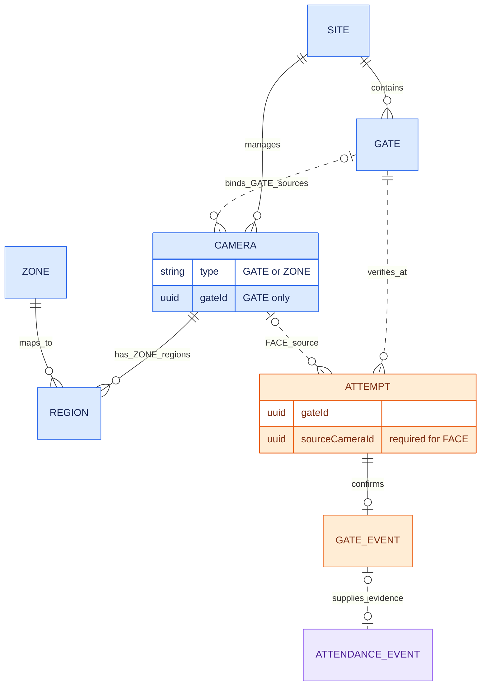

# Gate registry and registered FACE sources

Site Managers configure physical Gates within their assigned Site through the scoped
Gate API. Gate Desk and visitor workflows load this Site catalog instead of a fixed
list. Name-only creation generates a code such as `GATE-12ABCDEF3456`; explicit valid
codes remain supported for older clients. The Site Setup creation panel is delivered
in the dependent Web UI PR.
Each Gate has a UUID, a Site-scoped immutable code, a name and ACTIVE/INACTIVE status.
Names and status can change; Site/code cannot. There is no delete API.
Admin observes configuration. Site Manager, Safety Officer and Security Officer read their Site's
Gate catalog. Gate Desk operations remain restricted to Security Officer.

Camera creation explicitly selects **GATE** or **ZONE**. GATE requires an ACTIVE Gate in the
same Site and receives `gate-webcam-<camera UUID>` from Backend. The operator still captures
frames from the browser webcam. A browser device ID is a local capture preference, not a
registered Camera ID or proof of physical device identity. Purpose and Gate binding are immutable. A GATE Camera stays in its Gate's Site. Deactivate the old configuration and create another Camera when purpose changes.
ZONE has `gateId=null` and retains its existing source identifier workflow.

## API changes

All paths are under `/api/v1`.

| Method and route                                           | Behavior                                                                                |
| ---------------------------------------------------------- | --------------------------------------------------------------------------------------- |
| GET `/sites/:siteId/gates?offset=0&limit=20&status=ACTIVE` | `{items,total}`; status filter optional; includes inactive history when omitted         |
| POST `/sites/:siteId/gates`                                | Manager only; `{name,code?}`; omitted code is generated; defaults ACTIVE                |
| GET `/sites/:siteId/gates/:gateId`                         | Read configuration including inactive Gates                                             |
| PATCH `/sites/:siteId/gates/:gateId`                       | Manager only; `{name?,status?}`; rejects ID/code/Site fields                            |
| GET `/sites/:siteId/gates/:gateId/sources`                 | Scoped minimal list of ACTIVE GATE Cameras bound to this ACTIVE Gate; Security may read |
| GET `/visitor-registration/sites/:siteId/gates`            | Public ACTIVE Gates; only UUID/code/name                                                |
| POST `/sites/:siteId/cameras`                              | Adds required `type`, `gateId` for GATE; ZONE uses externalId and null/omitted gateId   |
| POST `/sites/:siteId/gates/:gateId/face-presence`          | Multipart frame, sessionId and required sourceCameraId UUID                             |
| POST `/sites/:siteId/gates/:gateId/face-verifications`     | Multipart frame, direction and required sourceCameraId UUID                             |

Name-only creation is additive: older clients may still submit an explicit valid code.
Generated codes use the new Gate UUID's first twelve hexadecimal digits, with a `GATE-`
prefix. The existing Site/code unique constraint remains authoritative; a generated-code
collision retries the complete authorized transaction with a new UUID, at most three attempts.
Existing codes remain immutable when renaming or changing status. Deploy Backend before
the updated Web. No database migration or renumbering is needed for code generation.

Access Attempt, Gate Access Log, Visit and QR Fallback Session now store Gate UUIDs with
same-Site foreign keys. FACE Attempts store a registered source; QR/MANUAL use null.
Gate Event retains a Gate-name snapshot, while Visitor Event responses obtain Gate UUID from
the linked Attempt. Source trace is Attendance Event → Gate Event → Attempt → Gate/Camera.
No Camera is added to Attendance Day.

FACE validates Gate/source before AI, scopes presence by actor/Site/Gate/Camera/session,
and validates Gate/source again under transaction locks before confirming passage.
Confirmation retries return the already-recorded Event before checking new-action eligibility.
Existing Site permission, IN/OUT, schedule, idempotency and attendance reconciliation remain.
FACE auto-confirms after ALLOWED; there is no new physical confirmation step.

Gate Desk selects the dynamic Gate catalog and registered Camera before browser capture.
A sole source is selected automatically; several require a choice. Missing/unavailable sources
block FACE and retain authorized QR fallback. Gate, registered Camera, Site or session changes
remount the scan workspace; webcam/direction changes invalidate scan generation and pending results.
Visitor Registration, Visitor Access and Gate Observation use Backend-authored Gate names.
Inactive Gates remain readable for history and cannot authorize new actions.

## Schema rollout

Migration `GateRegistry1795046400001` is registered in the default migration list.
It accepts a clean target, or a legacy target containing only unambiguous Zone cameras:
every existing Camera must have at least one observation Region, every Region's Camera and
Zone must belong to the same Site, and all four legacy Gate-flow tables must be empty.
Under transaction-held table locks, these cameras receive `type=ZONE`, retain null `gate_id`,
and Regions receive their validated Camera's Site ID. Existing IDs, revisions, geometry,
accounts and other fields are preserved. No Gate is invented or automatically created.

Cameras without Region evidence, cross-Site Region bindings and any existing Access Attempt,
Gate Access Log, Visitor Visit or QR Fallback Session still stop the migration. These targets
need an explicitly reviewed mapping/deployment plan or a separate clean development target.
No data is deleted/truncated and synchronize remains disabled. Back up the target, rehearse
the transaction, then run the registered migration before using the updated Backend.

Create Sites/accounts with existing setup, then create Gates and Cameras through Site Manager APIs/UI.
Fresh synthetic integration fixtures include multiple Sites, Gates and typed Cameras.
The dedicated PostgreSQL integration runner accepts only the validated smartsite_test target;
file-owned schema suites additionally require port 5433. Historical migration rehearsals explicitly
retain their old migration boundary, with projection columns for current Camera ORM readers;
the complete Gate schema is tested independently from clean migrations.

Camera GATE is excluded from Region creation, monitoring snapshots, worker generation,
event admission, preview/authoring capture and PPE policy writes. Region has database-enforced
Camera/Site and Zone/Site foreign keys and rejects GATE Cameras. ZONE can exist without Regions.
The PPE v2 prototype migration remains outside default, and tracked-v16 stays opt-in.
AI wire formats, vendored contracts, models and runtimes are unchanged. PPE v2 consumer rollout
and hardware/model validation are not claimed by this change.

## Relevant ERD

The complete conceptual model remains broader than the physical table list. No retired
worker_gate_permission, timesheet replica or visitor_gate_event table is restored.
