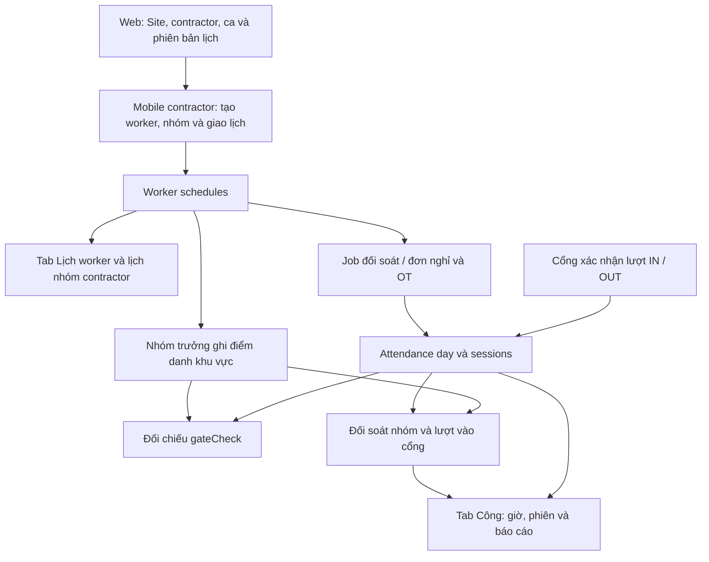

# Rà soát chức năng mobile, API và nguồn tạo dữ liệu

Cập nhật giao diện ngày 21/11/2026: Mobile Contractor đã bỏ hai tab Phân công và Quyền vào trong Khu vực; chỉ còn danh sách khu vực và chi tiết. API điều phối/cấp/thu hồi quyền cá nhân vẫn có ở Backend nhưng không còn được gọi từ màn này. Hồ sơ Worker/Contractor đã bỏ mục Thông báo thiết bị; đăng xuất cần xác nhận. Các số liệu rà soát ngày 20/11 bên dưới là ảnh chụp trước thay đổi giao diện này.

Các chức năng Contractor đã được đồng bộ sang Web trong cùng đợt cập nhật; xem [bảng đối chiếu Web/Mobile](contractor-web-mobile-parity.md). Worker tiếp tục triển khai trên Mobile theo phạm vi đã chốt.

Ngày đối chiếu: **20/11/2026**. Phạm vi là mã đang có tại `D:/SEP490/smartsite`, gồm **Worker** và **Contractor Representative**. Không suy ra chức năng mobile từ một API chỉ tồn tại trên web.

## 1. Kết quả chính

- Đã lần theo entry app và các import liên quan: **75 tệp**, **142 vị trí gọi API**, **101 hàm client**, tương ứng **102 cặp HTTP method + URL**.
- **102/102** thao tác này có route tương ứng trong mã controller và trong Swagger của backend local đang chạy.
- Phân bố: **44 GET**, **11 PATCH**, **38 POST**, **6 PUT**, **3 DELETE**. Các route tham số hóa như `kind`, `side` được tính là một mẫu route; `incidentCommand` gọi hai route khác nhau trên mobile.
- Không thấy một hàm API đang được mobile gọi mà hoàn toàn thiếu route backend. Các bước duyệt sửa công, đối soát nhóm/cổng, đổi/hủy batch và khôi phục mật khẩu đã được bổ sung; giới hạn kiểm chứng và push native được nêu ở mục 6.
- Đây là kiểm tra mã, đường gọi và route đăng ký. **Chưa phải thử toàn bộ thao tác bằng tài khoản thật, multipart upload, các tổ hợp quyền và dữ liệu thực.** Các bài kiểm tra tự động không dùng dữ liệu vận hành. Đã áp dụng ba migration cộng thêm cho tính năng mới; chưa gửi email thử tới người dùng thật.

[Danh mục đủ 102 thao tác: tên hàm, CRUD, HTTP/URL, công dụng, bước có trước, vị trí gọi và controller](mobile-api-inventory.vi.md).

Tất cả URL trong tài liệu có tiền tố **`/api/v1`**. Ví dụ `/sites/{siteId}/workers` thực tế là `/api/v1/sites/{siteId}/workers`.

## 2. Hai màn “chi tiết ngày” đang đọc hai loại dữ liệu khác nhau

| Nơi mở trên mobile                                              | API chính                                                           | Thực chất đang xem                                         | Dữ liệu xuất hiện sau bước nào?                                                                                     |
| --------------------------------------------------------------- | ------------------------------------------------------------------- | ---------------------------------------------------------- | ------------------------------------------------------------------------------------------------------------------- |
| Worker → Lịch → chọn ca/ngày                                    | `GET /sites/{siteId}/worker-schedules`                              | Lịch đã được giao cho worker                               | Contractor commit giao lịch, hoặc người có quyền tạo worker schedule từ web                                         |
| Worker → modal ngày trong Lịch                                  | `GET /sites/{siteId}/worker-schedules/{scheduleId}/zone-attendance` | Kết quả điểm danh khu vực của nhóm trưởng                  | Có lịch trước; ban đầu `NOT_YET`, sau khi nhóm trưởng lưu thành `PRESENT`/`ABSENT`                                  |
| Contractor → Lịch → lịch nhóm                                   | `GET /sites/{siteId}/schedule-assignments/calendar`                 | Lịch tổng hợp theo nhóm/ca/ngày và số người được phân công | Phải có worker schedules active, xác định được nhóm từ batch hoặc membership lịch sử                                |
| Worker → Công → chọn ngày; Contractor → Lịch → Công → chọn ngày | `GET /sites/{siteId}/attendance-days/{dayId}`                       | Ngày công thực tế, giờ tính công và phiên vào/ra cổng      | Backend đã hình thành attendance day từ lượt qua cổng được xác nhận, đơn thời gian hoặc tác vụ đối soát lịch sau ca |

**`scheduleId` không phải `dayId`.** Có lịch làm không đồng nghĩa đã có giờ công. Có mặt trong lịch nhóm không đồng nghĩa đã được nhóm trưởng đánh dấu có mặt. Các bản ghi chấm công cũng có thể xuất hiện sau khi gửi đơn nghỉ/OT hoặc khi hệ thống đối soát vắng sau ca; không chỉ sau lượt quét QR.

## 3. Bản đồ chức năng và CRUD

C = tạo; R = đọc; U = cập nhật; D = xóa, thu hồi hoặc lưu trữ theo nghiệp vụ. **POST không phải lúc nào cũng là tạo dữ liệu**: preview, kiểm tra ảnh và kiểm tra ngày chủ yếu là kiểm tra đầu vào. PUT bổ nhiệm nhóm trưởng là cập nhật một liên kết, không tạo một worker mới.

| Chức năng trên mobile                                          | Ai dùng?                                                 | CRUD của dữ liệu nào?                                                         | API/luồng hiện có                                                                                                                                                              | Ai/bước nào tạo dữ liệu gốc?                                                                                     |
| -------------------------------------------------------------- | -------------------------------------------------------- | ----------------------------------------------------------------------------- | ------------------------------------------------------------------------------------------------------------------------------------------------------------------------------ | ---------------------------------------------------------------------------------------------------------------- |
| Đăng nhập, khôi phục phiên, đổi mật khẩu, đăng xuất            | Cả hai                                                   | Phiên đăng nhập và mật khẩu user                                              | `auth/login`, `refresh`, `me`, `change-password`, `logout`                                                                                                                     | Quản trị cấp tài khoản/quyền trước; mobile không tự đăng ký tài khoản đại diện                                   |
| Chọn công trường/phạm vi                                       | Cả hai, theo tài khoản                                   | R Site, role, contractor scope                                                | `GET /sites`, `/auth/me`, `/contractor-dashboard/scopes`                                                                                                                       | Người quản lý thiết lập Site, contractor tham gia và gắn đại diện                                                |
| Trang chủ Worker/Contractor                                    | Theo vai trò                                             | R tổng hợp lịch, nhóm, ngày công, đếm nhân lực/đơn                            | `my-team`, `worker-schedules`, `attendance-days`, contractor `dashboard`, `shift-requests`                                                                                     | Lấy từ dữ liệu nghiệp vụ bên dưới; không có thao tác “tạo dashboard”                                             |
| Danh sách công nhân, tạo tài khoản, sửa hồ sơ nhân lực         | Contractor                                               | C/R/U user + worker; active/inactive thay cho xóa cứng                        | `GET workers`, `POST /contractors/{contractorId}/worker-accounts`, `PUT .../workers/{workerId}`                                                                                | Contractor → Nhân lực → Tạo công nhân                                                                            |
| Xem/nộp hồ sơ, chứng chỉ                                       | Contractor nộp cho worker; Worker nộp chứng chỉ của mình | C/R/U ảnh định danh và tài liệu worker; R compliance tổng hợp                 | `compliance`, `identity-images`, `documents/{kind}`, `documents/{kind}/check`, `submitted-expiry`, file/OCR endpoints                                                          | Tạo worker → nộp tệp → Safety Officer xét duyệt trên web                                                         |
| Tạo/sửa/lưu trữ nhóm                                           | Contractor                                               | C/R/U/D nghiệp vụ của `contractor_team`                                       | `GET/POST teams`, `GET/PATCH teams/{id}`, `POST .../archive`                                                                                                                   | Contractor → công cụ quản lý → Nhóm → Tạo nhóm                                                                   |
| Thêm/chuyển/gỡ thành viên, bổ nhiệm nhóm trưởng                | Contractor                                               | C/U/D membership; U `leaderWorkerId`                                          | `PUT .../team-workers/{workerId}/team`, `PUT .../teams/{teamId}/leader`                                                                                                        | Đã có worker và nhóm; bổ nhiệm từ một thành viên của nhóm                                                        |
| Gán/sửa/thu hồi khu vực nhóm                                   | Contractor                                               | C/R/U/D nghiệp vụ của `team_zone_permission`                                  | `GET/POST .../teams/{id}/zones`, `PATCH .../zones/{id}`, `POST .../revoke`                                                                                                     | Site Manager cấp quyền khu vực cho contractor trước; contractor phân tiếp cho nhóm                               |
| Gửi điều phối worker, cấp/thu hồi quyền khu vực worker         | Contractor; Worker xem phạm vi mình                      | C/R assignment; C/R/D permission worker                                       | `access-setup`, `site-zone-assignment-requests`, `worker-zone-permissions`                                                                                                     | Có worker/participation → yêu cầu điều phối → Safety review → Site Manager decision → cấp quyền phù hợp          |
| Giao lịch nhóm, xem lịch cá nhân/nhóm                          | Contractor giao; Worker xem                              | C batch + worker schedules; R ca/phiên bản/quyền dùng ca; R calendar tổng hợp | `schedule-assignments/preview`, `POST schedule-assignments`, `GET .../calendar`, `worker-schedules`                                                                            | Web chuẩn bị ca/phiên bản và gán ca cho contractor; mobile preview rồi commit                                    |
| Đổi ca, hoán đổi, đồng ý/từ chối hoán đổi                      | Worker và Contractor ở các bước khác nhau                | C/R/U đơn và lịch liên quan                                                   | `eligible-shifts`, `swap-candidates`, change/swap requests, `confirm`, `decline`, `approve`, `reject`                                                                          | Có lịch trước → worker tạo đơn → người được mời xác nhận nếu swap → contractor xét duyệt                         |
| Nghỉ phép toàn ca/theo khoảng thời gian, tăng ca, ghi nghỉ hộ  | Worker gửi; Contractor duyệt/ghi nghỉ hộ theo quyền      | C/R/U absence/overtime request; backend tính lại công liên quan               | `absence-requests`, `attendance-time-requests`, `.../{kind}/{id}/review`                                                                                                       | Có lịch → nhập thời gian/lý do → gửi → duyệt. Không tạo một API “nghỉ” độc lập cho từng màn                      |
| QR vào/ra                                                      | Worker                                                   | C QR credential; cập nhật/thu hồi mã cũ                                       | `POST /sites/{siteId}/worker-qr` với chiều IN/OUT                                                                                                                              | Worker có tài khoản đúng Site; cấp QR IN kiểm tra hồ sơ. Xác minh tại cổng và xác nhận passage là bước tiếp theo |
| Xem ngày công, phiên cổng, tổng giờ/bảng công, yêu cầu sửa giờ | Worker/Contractor đọc; Worker gửi sửa                    | R attendance day/session và số liệu tính; C correction request                | `attendance-days`, `attendance-days/{id}`, `attendance?dayId=...`, `attendance-summary`, `attendance-timesheets`, `attendance-workers`, `attendance-export`, `.../corrections` | Passage/đơn/tác vụ đối soát tạo dữ liệu; sửa giờ cần đơn được duyệt mới đổi effective times                      |
| Điểm danh tại khu vực và sửa sai sót                           | Nhóm trưởng ghi; Worker thường đọc                       | C/R/U `team_attendance`                                                       | `GET/PUT .../worker-schedules/{scheduleId}/zone-attendance`                                                                                                                    | Nhóm + membership + leader + lịch + khu vực hợp lệ; đến giờ bắt đầu ca mới có thể lưu                            |
| Checklist được giao                                            | Contractor được giao                                     | R/U checklist; C submission và evidence                                       | `GET safety-checklists`, detail, `POST .../start`, `POST .../submissions`, evidence                                                                                            | Safety Officer tạo/giao trên web trước; contractor mới thấy việc của mình                                        |
| Việc khắc phục sự cố                                           | Contractor được giao                                     | R incident; U corrective action; C submission/evidence                        | `GET incidents`, detail, `POST .../actions/{id}/start`, `.../submissions`, evidence                                                                                            | Safety Officer tạo incident và giao corrective action từ web                                                     |
| Thông báo, đánh dấu đọc, xóa                                   | Cả hai                                                   | R/U/D notification                                                            | `GET /me/notifications`, `PATCH .../read`, `.../read-all`, `DELETE .../{id}`, `DELETE .../read`                                                                                | Backend tạo từ sự kiện nghiệp vụ; mobile không tự POST tạo thông báo                                             |
| Hồ sơ tài khoản, đổi ngôn ngữ, chọn tệp, chia sẻ báo cáo       | Cả hai                                                   | R hồ sơ; U mật khẩu; phần còn lại là xử lý tại máy                            | Hồ sơ từ `/auth/me`; đổi ngôn ngữ/chọn ảnh/chia sẻ không cần CRUD HTTP                                                                                                         | User đã đăng nhập; tài liệu thật vẫn phải đi qua API upload                                                      |

### Quyền khu vực nhóm và worker không phải một thứ

`team_zone_permission` là quyền khu vực của nhóm. `worker_zone_permission` là quyền riêng cho worker, dựa trên assignment được duyệt và quyền contractor làm cha. Backend xét quyền khu vực có hỗ trợ nhánh quyền nhóm, nhưng nhánh này **vẫn cần worker-site-zone assignment APPROVED, đúng Zone và đúng khoảng hiệu lực**. Vì vậy, chỉ thêm worker vào nhóm hoặc chỉ gán Zone cho nhóm chưa tự hoàn thành quy trình duyệt điều phối worker.

Nguồn: [zone-entry-authorization.service.ts](../../apps/backend/src/modules/zones/zone-entry-authorization.service.ts), [site-access-setup.service.ts](../../apps/backend/src/modules/workforce/access/site-access-setup.service.ts).

## 4. Muốn dữ liệu xuất hiện thì làm theo thứ tự nào?

### A. Để contractor đăng nhập và nhìn thấy đúng Site

1. Quản trị/người phụ trách tạo Site, contractor và tài khoản đại diện trên web.
2. Thiết lập contractor tham gia Site với khoảng hiệu lực phù hợp; gắn đại diện vào đúng contractor/Site.
3. Đại diện đăng nhập mobile, đổi mật khẩu nếu tài khoản bắt buộc đổi.
4. Mobile đọc `auth/me`, `sites`, `contractor-dashboard/scopes` để cho chọn phạm vi.
5. Chọn phạm vi xong, các API phía dưới đều chạy trong Site/Contractor đó. Không có scope hợp lệ thì dữ liệu không xuất hiện dù một contractor khác có dữ liệu.

### B. Để có công nhân, nhóm và nhóm trưởng

1. Contractor → Nhân lực → Tạo công nhân: nhập email người nhận, rồi gọi `POST /contractors/{contractorId}/worker-accounts`.
2. Backend tạo **user + worker + compliance profile**, lưu email và xếp email tên đăng nhập/mật khẩu ban đầu/mã xác minh vào hàng đợi trong cùng transaction. Dùng chung cấu hình Resend của visitor; QUEUED nghĩa là chờ gửi, không khẳng định đã tới hộp thư. Các ảnh CCCD/chứng chỉ được upload bằng các request tiếp theo; đây không phải một request tạo account chứa toàn bộ file.
3. Sau tạo, `GET /sites/{siteId}/workers` có thể trả worker này. Upload thất bại sau tạo account không có nghĩa account chưa được tạo; cần xử lý hoàn tất hồ sơ/luồng retry.
4. Contractor tạo nhóm bằng `POST .../teams`.
5. Thêm worker vào nhóm bằng `PUT .../team-workers/{workerId}/team`. Tạo nhóm không tự thêm toàn bộ công nhân.
6. Bổ nhiệm nhóm trưởng bằng `PUT .../teams/{teamId}/leader`.
7. Worker đọc `GET .../my-team` để biết nhóm/khu vực của mình; worker không phải gọi API tạo nhóm.

### C. Để lịch nhóm và lịch worker hiện ra

1. Người có quyền thiết lập lịch trên web tạo **shift**: `POST /sites/{siteId}/shifts`.
2. Gán ca cho contractor: `POST /sites/{siteId}/shifts/{shiftId}/contractors`.
3. Tạo phiên bản lịch: `POST /sites/{siteId}/schedule-versions` với hiệu lực bao phủ ngày muốn giao.
4. Contractor có nhóm có thành viên active.
5. Mobile chọn nhóm/ca/phiên bản/ngày rồi gọi `POST .../schedule-assignments/preview`.
6. **Preview chỉ kiểm tra, chưa tạo lịch.** Phải xác nhận lưu bằng `POST .../schedule-assignments`.
7. Backend tạo batch và các **worker schedules**.
8. Worker đọc `GET .../worker-schedules` để xem lịch của mình; contractor đọc `GET .../schedule-assignments/calendar` để xem lịch nhóm.
9. Calendar nhóm cũng đọc được lịch cũ không có batch khi membership lịch sử xác định được nhóm tại đầu ca. Nếu không xác định được nhóm, API trả số lịch chưa xác định nhóm; không tự gán lại lịch cũ cho nhóm hiện tại.

Hồ sơ đã được Safety duyệt là điều kiện quan trọng của quyền vào cổng, nhưng không nên nhầm đó là API tạo lịch. Mã giao lịch kiểm tra phạm vi, ca được cấp, phiên bản, thành viên/ngày hợp lệ và xung đột; không phải mọi trường hợp lịch trống đều do hồ sơ chưa duyệt.

Nguồn: [ScheduleAssignModal.tsx](../../apps/mobile/src/components/modals/ScheduleAssignModal.tsx), [schedule-assignment.service.ts](../../apps/backend/src/modules/workforce/scheduling/schedule-assignment.service.ts), [team-calendar.ts](../../apps/backend/src/modules/workforce/scheduling/team-calendar.ts).

### D. Để worker thấy Present/Absent trong modal ngày

1. Hoàn thành nhóm, thành viên và bổ nhiệm nhóm trưởng.
2. Site Manager cấp quyền Zone cho contractor; contractor gán Zone cho nhóm trong thời gian phù hợp.
3. Nhóm có lịch active; quyền nhóm/contractor/participation phải hợp lệ tại đầu ca. Hiện service cần xác định được **đúng một Zone**; không có hoặc có nhiều Zone phù hợp sẽ không xác định được Zone để nộp.
4. Nhóm trưởng mở lịch **của chính mình** → chọn ca → API `GET .../zone-attendance` trả `canManage`, `canSubmit`, roster và trạng thái từng người.
5. Trước giờ bắt đầu, lịch bị hủy, toàn bộ bản ghi đã khóa hoặc Zone không hợp lệ thì không được nộp dù là nhóm trưởng.
6. Nhóm trưởng chọn có mặt/vắng và lưu `PUT .../zone-attendance`. Mỗi lựa chọn mang `scheduleId`, `expectedMembershipId`, `expectedVersion`; sửa bản cũ phải có lý do.
7. Worker thường mở modal của mình: đọc `own.status` là `NOT_YET`, `PRESENT` hoặc `ABSENT`. Endpoint không mặc định cho worker thường sửa cả nhóm.
8. `gateCheck` đối chiếu: `MATCHED` = có mặt và có bằng chứng vào cổng; `NO_GATE_ENTRY` = có mặt nhưng chưa có bằng chứng vào; `GATE_ONLY` = có bằng chứng vào nhưng chưa được ghi có mặt; `NOT_YET` = chưa có đối chiếu tương ứng. Không nên diễn giải `GATE_ONLY` như bằng chứng chắc chắn làm sai khu vực.

Nguồn: [team-attendance.service.ts](../../apps/backend/src/modules/workforce/teams/team-attendance.service.ts), [schedule-day-sheet.tsx](../../apps/mobile/src/features/scheduling/schedule-day-sheet.tsx).

### E. Để có ngày công và giờ xác nhận trong tab Công

1. Worker có lịch; chuẩn bị hồ sơ/quyền cần thiết của luồng cổng.
2. Worker yêu cầu mã IN/OUT qua `POST .../worker-qr`. **Cấp hoặc hiển thị QR chưa phải ghi nhận qua cổng.**
3. Luồng cổng xác minh, ví dụ `POST .../gates/{gateId}/qr-verifications`, rồi xác nhận passage bằng `POST .../access-attempts/{attemptId}/confirm` theo quyền của bên vận hành cổng. Đây không phải bước worker tự xác nhận bằng việc mở QR trên điện thoại.
4. Passage được ghi nhận sẽ tạo/cập nhật attendance event, session và attendance day qua reconciliation. Các nguồn dữ liệu khác gồm đơn nghỉ/OT tạo ngày liên quan và job đối soát lịch sau ca để phát hiện vắng.
5. Mobile đọc `attendance-days`, `attendance-days/{dayId}` và các API tổng hợp.
6. Backend tính giờ dựa vào phiên cổng, lịch, nghỉ/OT được duyệt, chính sách và bất thường. Với ca thuộc nhóm bắt đầu từ thời điểm triển khai chính sách, phải có nhóm trưởng ghi PRESENT, đúng nhóm/membership/Zone và có CHECK_IN gắn sự kiện cổng thật; thiếu/lệch thì NEEDS_REVIEW. Các ngày đã xác nhận trước đó không bị áp lại chính sách. Ngày đủ điều kiện sau ca có thể tự thành `CONFIRMED`; không phải ngày nào cũng cần bấm một nút chốt thủ công.
7. Nếu thiếu vào/ra, trùng lượt vào, thiếu lịch hoặc còn đơn chờ thì có thể cần xử lý trước. Worker gửi correction bằng `POST .../attendance-sessions/{sessionId}/corrections`; raw scans được giữ nguyên.
8. Đại diện có quyền duyệt correction trên **mobile hoặc web** bằng `POST .../attendance-corrections/{correctionId}/review`; mobile chỉ hiện action khi backend trả capability tương ứng. Endpoint `attendance-days/{dayId}/confirm` xử lý xác nhận trường hợp ngoại lệ phù hợp, không phải lệnh ép mọi ngày thành đã xác nhận.
9. Khi đủ điều kiện, giờ confirmed mới đi vào bảng công đã xác nhận và báo cáo.

Nguồn: [qr-access.service.ts](../../apps/backend/src/modules/workforce/access/qr-access.service.ts), [attendance-reconciliation.service.ts](../../apps/backend/src/modules/workforce/attendance/attendance-reconciliation.service.ts), [attendance-days.service.ts](../../apps/backend/src/modules/workforce/attendance/attendance-days.service.ts).

### F. Để có hồ sơ/chứng chỉ đã được duyệt

1. Tạo worker trước để có `workerId`.
2. Contractor nộp CCCD FRONT/BACK và các chứng chỉ của worker; Worker có thể nộp các chứng chỉ của chính mình từ Hồ sơ.
3. Upload tạo bản nộp và dữ liệu kiểm tra/OCR; ngày khai báo có API kiểm tra riêng. Bản upload không tự đồng nghĩa đã được duyệt.
4. Safety Officer xét duyệt hồ sơ/tài liệu từ web theo quyền. Mobile hiện phục vụ nộp và xem, không đóng vai Safety Officer để duyệt hồ sơ.
5. `GET .../workers/{workerId}/compliance` tổng hợp trạng thái để hiển thị; không cần tạo “compliance card” bằng một POST riêng.

### G. Để có đơn, checklist, việc khắc phục và thông báo

- **Đổi ca:** có lịch → lấy eligible shifts → gửi đơn → contractor duyệt/từ chối → backend cập nhật lịch khi hợp lệ.
- **Hoán đổi:** có lịch → lấy swap candidates → gửi đơn → người được mời đồng ý/từ chối → contractor xét duyệt. Chỉ gửi đơn chưa làm hai lịch hoán đổi ngay.
- **Nghỉ/OT:** có lịch → gửi đơn → danh sách nghỉ/OT đọc được request → contractor xét duyệt theo quyền → hệ thống tính lại công liên quan. Luồng `absence-requests` từ lịch và `attendance-time-requests` loại LEAVE có thể cùng làm việc với dữ liệu nghỉ; không phải hai loại ngày công độc lập.
- **Checklist:** Safety Officer tạo/giao trên web → contractor được giao thấy danh sách → start → nộp kết quả/ảnh → Safety xét duyệt.
- **Việc khắc phục:** Safety Officer tạo incident và giao corrective action → contractor thấy việc → start action → nộp kết quả → xét duyệt. Mobile không có thao tác tạo incident mới trong màn này.
- **Thông báo:** một bước nghiệp vụ tạo notification → mobile polling danh sách/badge → đọc/xóa. Không cần user tự tạo một notification mới để danh sách có dữ liệu.

## 5. Các ID thường dễ nhầm

| Tham số                           | Lấy từ đâu?                                                           | Không nên hiểu là                                     |
| --------------------------------- | --------------------------------------------------------------------- | ----------------------------------------------------- |
| `siteId`                          | Scope sau `/auth/me`, `/sites`, dashboard scopes                      | Tên công trường hoặc ID contractor                    |
| `contractorId`                    | Scope contractor hợp lệ                                               | ID user đại diện                                      |
| `workerId`                        | Tạo worker-account; listWorkers; my-team                              | `userId` của tài khoản worker                         |
| `teamId`                          | Tạo/list/detail nhóm                                                  | Một mảng worker IDs                                   |
| `membershipId`                    | Kết quả thành viên nhóm/roster                                        | workerId; cần giữ đúng bản membership khi chuyển nhóm |
| `zoneId`                          | Zone do người quản lý tạo; các setup API trả lại                      | ID bản cấp quyền Zone                                 |
| `contractorZonePermissionId`      | `access-setup` / team-zone setup từ quyền Site Manager cấp            | zoneId                                                |
| `workerAssignmentId`              | Yêu cầu điều phối đã được duyệt                                       | workerScheduleId                                      |
| `shiftId`                         | `GET .../shifts`                                                      | workerScheduleId                                      |
| `scheduleVersionId`               | `GET .../schedule-versions`                                           | Version concurrency của một attendance record         |
| `scheduleId` / `workerScheduleId` | Worker schedule được tạo sau lưu phân công                            | dayId hoặc shiftId                                    |
| `dayId`                           | `GET .../attendance-days` hoặc notification liên quan                 | Ngày dạng `2026-11-20` hoặc scheduleId                |
| `sessionId`                       | `GET .../attendance-days/{dayId}` / attendance overview               | dayId; một ngày có thể có nhiều phiên                 |
| `documentId` / image `id`         | Compliance/doc upload response                                        | Worker ID hoặc tên `kind`                             |
| `requestId` / `commandId`         | Từng API quy định: ID lệnh chống lặp hoặc ID tài nguyên đơn trong URL | Một tham số có thể thay thế tùy ý cho mọi loại ID     |

## 6. Kết quả bổ sung và phần còn cần kiểm chứng

| Phần                             | Đã bổ sung trên mobile/backend                                                                                                     | Đường vào và điều kiện                                                                                                                                     |
| -------------------------------- | ---------------------------------------------------------------------------------------------------------------------------------- | ---------------------------------------------------------------------------------------------------------------------------------------------------------- |
| Duyệt sửa giờ                    | Approve/reject, reject cần lý do; backend trả canReview, không tự duyệt đơn mình                                                   | Contractor → Lịch → Công → ngày công → yêu cầu sửa                                                                                                         |
| Xử lý phiên trùng / ngoại lệ     | Action theo capability, gửi expectedVersion và lý do; giữ lượt quét gốc                                                            | Chi tiết ngày công; xác nhận rời sớm không bỏ qua thiếu bằng chứng Zone                                                                                    |
| Tổng điểm danh nhóm              | API riêng đúng Site/Contractor, roster phân trang, tổng present/absent/pending/matched                                             | Contractor → Lịch → chọn ngày và ca của nhóm                                                                                                               |
| Điều kiện chốt công              | Snapshot nhóm/membership/Zone tại đầu ca; PRESENT + CHECK_IN cổng thật mới đủ bằng chứng khu vực                                   | Ca bắt đầu sau thời điểm triển khai; thiếu/lệch chờ kiểm tra. Còn phải thỏa các điều kiện giờ công khác                                                    |
| Sửa/hủy lịch đã giao             | Đổi ca/hủy theo ngày, từ ngày hoặc toàn bộ chưa bắt đầu; lý do, version và requestId chống lặp                                     | Contractor → Lịch → Quản lý lịch đã giao; API bảo vệ ca đã bắt đầu/có chấm công; không tự dựng batch cho lịch cũ                                           |
| CSV tại màn contractor           | Báo cáo/xuất CSV dùng API hiện có và tôn trọng bộ lọc worker                                                                       | Contractor → Lịch → Công → Báo cáo                                                                                                                         |
| Email tạo worker                 | Mobile yêu cầu email, backend sinh mật khẩu riêng khi không truyền; hàng đợi mã hóa nội dung, thử lại có giới hạn                  | Contractor → Nhân lực → Tạo công nhân. Email cũ chưa được tự coi là đã xác minh                                                                            |
| Xác minh/quên mật khẩu           | Đổi email cần mật khẩu hiện tại; mã 10 phút, tối đa 5 lần thử, gửi lại sau 60 giây; reset thu hồi phiên cũ                         | Hồ sơ → Email; Đăng nhập → Quên mật khẩu. Chỉ email đã xác minh được khôi phục                                                                             |
| Thông báo native                 | API đăng ký thiết bị gắn phiên MOBILE, token mã hóa, hàng đợi/receipt và thu hồi thiết bị; payload chung không kèm dữ liệu cá nhân | Đã chuẩn bị mã/config, EXPO_PUSH_ENABLED mặc định false; chưa có EAS projectId và chưa build theo yêu cầu người dùng. Expo Go tiếp tục thông báo trong app |
| Thiết lập/xét duyệt vai trò khác | Site/Zone/ca/phiên bản lịch, duyệt hồ sơ, tạo incident/checklist vẫn theo quyền web                                                | Đây là bước của vai trò quản lý/Safety; không phải thiếu API của Worker/Contractor                                                                         |
| Hồ sơ doanh nghiệp/đại diện      | Luồng chứng chỉ đang làm việc với workerId                                                                                         | Không suy thành kho hồ sơ pháp lý doanh nghiệp mới; phạm vi này chưa có yêu cầu dữ liệu/duyệt riêng                                                        |

Đã triển khai ba migration: MobileAttendanceCompletion1795305600000, AccountEmailRecovery1795392000000, MobilePushDelivery1795478400000. Chỉ chạy đúng ba migration này, không chạy các migration Gate đang làm dở. Backend readiness trả 200; schema và truy vấn roster được kiểm tra bằng EXPLAIN trên DB vận hành, không tạo dữ liệu nghiệp vụ thử.

Các integration test PostgreSQL đã bổ sung và biên dịch được, nhưng **chưa chạy** vì chưa có TEST_DATABASE_URL/PostgreSQL test riêng ở cổng 5433. Không dùng DB vận hành để chạy test tự động. Chưa xác nhận email tới hộp thư thật, chưa kiểm thử push trên thiết bị native, chưa build app.

Kiểm tra dependency online báo có các bản vá Expo mới được khuyến nghị. Bộ package hiện tại khớp manifest SDK đã cài khi đối chiếu offline; không nâng hàng loạt package trong tính năng này. Cần xử lý/kiểm tra lại trước bản build native về sau.

## 7. API bổ sung trong phần điểm danh nhóm gần đây

Đối chiếu mã đang làm với `HEAD` của checkout để phân biệt API bổ sung với việc chỉ chỉnh giao diện. Bốn thao tác dưới đây là phần bổ sung của luồng nhóm/điểm danh/lịch nhóm; chúng đã có trong Swagger local ở thời điểm rà soát.

| API                                                                    | Loại thay đổi/dữ liệu                                                | Khi nào được gọi?                          |
| ---------------------------------------------------------------------- | -------------------------------------------------------------------- | ------------------------------------------ |
| `PUT /sites/{siteId}/contractors/{contractorId}/teams/{teamId}/leader` | U liên kết nhóm trưởng trên team; không tạo worker                   | Contractor bổ nhiệm/gỡ nhóm trưởng         |
| `GET /sites/{siteId}/worker-schedules/{scheduleId}/zone-attendance`    | R trạng thái điểm danh/đối chiếu cổng; không tạo attendance day      | Worker/nhóm trưởng mở modal lịch           |
| `PUT /sites/{siteId}/worker-schedules/{scheduleId}/zone-attendance`    | C/U team attendance, có version/membership và lý do sửa              | Nhóm trưởng lưu điểm danh hoặc sửa sai sót |
| `GET /sites/{siteId}/schedule-assignments/calendar`                    | R tổng hợp worker schedules thành lịch nhóm; không tạo bảng lịch mới | Contractor mở lịch nhóm                    |

Các thay đổi giao diện ngày công, modal hồ sơ/chứng chỉ hoặc nhóm không tự có nghĩa đã tạo một API mới cho mỗi thẻ/nút. Ví dụ `GET compliance`, `GET attendance-days/{id}` và API upload tài liệu được dùng lại cho cách trình bày mới.

## 8. Cách đọc kết quả kiểm tra

Với một màn đang trống, kiểm tra theo thứ tự: **đúng role/scope → có dữ liệu gốc → dữ liệu đã được duyệt/còn hiệu lực → đúng khoảng ngày/filter → đúng capability → response API**. Không nên tạo dữ liệu giả ở UI để lấp trạng thái trống.

Tài liệu đã được cập nhật sau khi bổ sung tính năng. Danh mục API ghi rõ CRUD, điều kiện dữ liệu và nơi gọi thực tế; giới hạn kiểm chứng ở mục 6 vẫn cần được giữ khi đánh giá hoàn tất. Cấu hình email được dùng lại từ QR visitor, không yêu cầu thêm dịch vụ hoặc API key mới.
